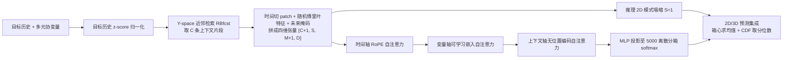

# Baguan-TS

Baguan-TS 是一套面向含协变量时间序列预测的序列原生上下文学习（ICL）基础模型[^src-baguan-ts]。现有两类零样本路线存在明显断点：以表格基础模型为核心的 ICL 方案需要人工构造时间与季节特征，把预测改写为表格回归，推理开销较高；而主流端到端时序基础模型虽能直接读取原始数值波形，却缺乏推理期无需梯度更新的多样例上下文适应能力[^src-baguan-ts]。Baguan-TS 将两条路径合二为一：把目标历史、多元协变量与目标空间近邻检索出的上下文片段直接编排为序列原生四维张量，沿时间、变量与上下文三根正交轴依次做分解自注意力，再辅以防过平滑的上下文过拟合训练目标与双模式分箱概率输出，在不做下游微调的情况下完成协变量零样本预测[^src-baguan-ts]。

## 问题定位

围绕零样本时间序列预测与协变量利用，既有工作沿两条互不兼容的路线演进[^src-baguan-ts]：

- **表格化 ICL 路线**：以 [[tabpfn-ts|TabPFN-TS]] 为代表，先手工构建归一化时间索引与预定义傅里叶基函数，再调用表格基础模型 TabPFN 做无梯度回归，虽具备天然协变量拼接与不确定性输出能力，但依赖特征工程且推理延迟偏高[^src-time-indexed-imputation][^src-baguan-ts]。
- **端到端序列 TSFM 路线**：以 [[timesfm|TimesFM]]、[[chronos|Chronos]] 与 [[tirex|TiRex]] 为代表，直接消费原始数值或离散分箱序列，但在预训练后通常缺乏多示例上下文演示接口[^src-timesfm][^src-chronos][^src-tirex]；若要在下游接入外生协变量，往往需冻结骨干并额外训练前置或后置适配器（如 [[unified-covariate-adaptation|UniCA]]、[[cora-tsfm|CoRA]]、[[chronosx|ChronosX]]），从而失去纯零样本即插即用特性[^src-unica][^src-cora][^src-chronosx]。

即便直接把「上下文样例 × 时间 × 变量」拼接成序列原生三维结构，也面临两项障碍：全维度联合注意力的计算量随三轴乘积呈二次爆炸，且高容量上下文模型在训练中容易把输出平均化为平滑均值[^src-baguan-ts]。Baguan-TS 分别以三轴正交分解注意力、目标空间近邻检索校准（RBfcst）与上下文过拟合辅助目标来应对这两项障碍[^src-baguan-ts]。

## 机制拆解

剥离论文自定义模块命名后，Baguan-TS 的核心流程由标准算子组合而成：**目标序列 $z$-score 归一化与目标空间近邻检索（RBfcst） + 切分时间 patch 并叠加随机傅里叶特征与未来掩码 + 沿时间（带 RoPE）、变量（带可学习嵌入）、上下文三轴依次执行的多头自注意力块 + 训练期自检索过拟合辅助损失 + 5,000 分箱离散 softmax 概率头与 2D/3D 推理集成**[^src-baguan-ts]。

其设计包含三处关键协同机制[^src-baguan-ts]：

1. **三轴分解注意力（3D Axial Factorization）**：不在 $(C{+}1)\cdot S\cdot (M{+}1)$ 网格上做全连接注意力，而是依次沿时间轴（使用 [[rope|RoPE]] 捕获相对时间位置）、变量轴（加入可学习变量嵌入对齐目标与外生协变量）、上下文轴（不加位置编码以保持上下文样例置换对称性）分别执行注意力[^src-baguan-ts]。
2. **Y-space 近邻检索与上下文过拟合（RBfcst + Context Overfitting）**：先对目标序列历史做 $z$-score 归一化，在目标空间检索 $K_{\text{ctx}}$ 个近邻历史–未来片段组成上下文（不依赖人工特征构造）；训练期还故意将某条上下文片段原样复制进 query 并叠加自检索辅助损失，用于抑制高容量模型输出坍缩为平稳均值[^src-baguan-ts]。
3. **2D/3D 双模式推理集成**：推理时除了运行完整的 3D 分解模式（单次前向约 $0.43\text{ s}$，约为 TabPFN-TS 延迟的 $1/10$），还将时间轴塌缩为 $S=1$ 得到 2D 模式并与 3D 模式集成预测（集成总耗时 $3.67\text{ s}$，显存占用 $2715\text{ MB}$）[^src-baguan-ts]。

## 数据流与维度

> **维度符号**：$C$ 检索得到的上下文样例数（含查询样例共 $C{+}1$）；$S$ 单条序列切分后的时间 patch 数（含历史与未来未知占位，推理期 2D 模式塌缩为 $S=1$）；$M$ 外生协变量通道数（含单目标通道共 $M{+}1$）；$D$ 隐层通道维；$K=5000$ 离散分箱数（均匀覆盖 $[-10,10]$ 区间）。序列原始时间长度、patch 长度 $P$、3D 块堆叠层数 $L$、未来段 patch 数 $S_{\text{fut}}$ 及头/投影中间形状在核心切片中未展开，均按标准算子推断标注 `[INFERENCE]`[^src-baguan-ts]。

### Stage 1 · 归一化、Y-space 近邻检索与四维张量编码

对单目标序列历史做 $z$-score 归一化后，在目标空间检索 $K_{\text{ctx}}=C$ 个近邻上下文样本并与查询样本共同切分时间 patch，再叠加随机傅里叶编码 $e=[\cos(Wq+b);\,\sin(Wq+b)]$ 与未来掩码指示项，嵌入为统一四维张量[^src-baguan-ts]。

$$\begin{aligned}
\tilde{y},\, \mathcal{N}_{\text{ctx}} &= \operatorname{Retrieve}_{K_{\text{ctx}}}\!\left(\operatorname{ZScore}(y_{\text{hist}})\right) && \text{// } [L_{\text{hist}}] \xrightarrow{\text{目标空间近邻检索 [INFERENCE]}} [C, L_{\text{ctx}}, M{+}1]\ \text{——构造 } C \text{ 条含协变量的示范序列}\\
X_{\text{patch}} &= \operatorname{Patchify}\!\left([\,\mathcal{N}_{\text{ctx}};\; x_{\text{qry}}\,]\right) && \text{// } [C{+}1, L_{\text{tot}}, M{+}1] \xrightarrow{\text{按步长切 } S \text{ 段 [INFERENCE]}} [C{+}1, S, M{+}1, P]\ \text{——统一上下文与查询的 patch 网格}\\
e &= [\,\cos(Wq+b);\; \sin(Wq+b)\,] && \text{// } [S, \bcancel{d_q}] \times [\bcancel{d_q}, D/2] \to [S, D]\ \text{——随机傅里叶特征映射时间坐标 [INFERENCE]}\\
H^{(0)} &= \operatorname{Proj}(X_{\text{patch}} \oplus \mathbb{I}_{\text{fut}}) + e && \text{// } [C{+}1, S, M{+}1, P{+}1] \xrightarrow{\text{线性嵌入加时间编码 [INFERENCE]}} [C{+}1, S, M{+}1, D]\ \text{——生成四维主干输入}
\end{aligned}$$

### Stage 2 · 3D 轴分解自注意力堆叠

主干由 $L$ 层结构相同的 3D 轴分解块堆叠构成；每层依次冻结其余两轴作为批维度，仅沿时间、变量、上下文单轴做多头自注意力，避免全网格二次方开销[^src-baguan-ts]。训练期若启用上下文过拟合辅助目标，则将一条上下文原样复制进 query 并监督自检索重建（推理期关闭该分支）[^src-baguan-ts]。

$$\begin{aligned}
\tilde{H}_{\text{time}}^{(l)} &= \operatorname{Attn}_{S}\!\left(\operatorname{RoPE}\!\left(H^{(l-1)}\right)\right) && \text{// } [C{+}1, S, M{+}1, D] \xrightarrow{\text{沿 } S \text{ 维 RoPE 自注意力}} [C{+}1, S, M{+}1, D]\ \text{——建模单通道时序演化与相对位置}\\
\tilde{H}_{\text{var}}^{(l)} &= \operatorname{Attn}_{M+1}\!\left(\tilde{H}_{\text{time}}^{(l)} + E_{\text{var}}\right) && \text{// } [C{+}1, S, M{+}1, D] \xrightarrow{\text{沿 } M{+}1 \text{ 维加变量嵌入自注意力}} [C{+}1, S, M{+}1, D]\ \text{——对齐同一时间步的目标与多元协变量}\\
H^{(l)} &= \operatorname{Attn}_{C+1}\!\left(\tilde{H}_{\text{var}}^{(l)}\right) && \text{// } [C{+}1, S, M{+}1, D] \xrightarrow{\text{沿 } C{+}1 \text{ 维无位置编码自注意力}} [C{+}1, S, M{+}1, D]\ \text{——跨样本读取 } C \text{ 个近邻上下文模式}
\end{aligned}$$

### Stage 3 · 2D 塌缩集成与 5,000 分箱概率输出

末层输出切片取出查询样本的目标通道未来 patch 表示，经 MLP 投影至 $[-10,10]$ 区间内的 $K=5000$ 个离散分箱 logits；推理期另执行时间轴塌缩为 $S=1$ 的 2D 模式并与 3D 模式集成，最后对 softmax 概率分布分别求箱心期望与逆 CDF 分位数[^src-baguan-ts]。

$$\begin{aligned}
Z_{\text{qry}} &= \operatorname{Slice}_{\text{qry, target, fut}}\!\left(H^{(L)}\right) && \text{// } [C{+}1, S, M{+}1, D] \xrightarrow{\text{切片查询目标未来段 [INFERENCE]}} [S_{\text{fut}}, D]\ \text{——抽取待预测目标未来隐状态}\\
Z_{\text{qry}}^{(2\mathrm{D})} &= \operatorname{Baguan2D}\!\left(H^{(0)}_{S\to 1}\right) && \text{// } [C{+}1, 1, M{+}1, D] \xrightarrow{\text{塌缩时间维的 2D 前向 [INFERENCE]}} [S_{\text{fut}}, D]\ \text{——提供跨样本宏观统计分支}\\
p &= \operatorname{Ensemble}_{2\mathrm{D}/3\mathrm{D}}\!\left(\operatorname{softmax}(\operatorname{MLP}(Z_{\text{qry}}))\right) && \text{// } [S_{\text{fut}}, \bcancel{D}] \xrightarrow{\text{MLP 映至 } K{=}5000 \text{ 分箱并集成 [INFERENCE]}} [S_{\text{fut}}, K]\ \text{——输出 } [-10,10] \text{ 离散概率分布}\\
\hat{y},\, \hat{y}_q &= \sum_{k=1}^{K} p_k b_k,\; \operatorname{CDF}^{-1}(p, q) && \text{// } [S_{\text{fut}}, K] \xrightarrow{\text{沿 } K \text{ 维期望与逆 CDF 采样 [INFERENCE]}} [S_{\text{fut}}, 1]\ \text{——导出点预测与任意分位数并反归一化}
\end{aligned}$$

## 与既有工作的关系

Baguan-TS 在协变量基础模型与上下文学习谱系中占据独立路线[^src-baguan-ts]：

- **同槽位互斥（vs [[tabpfn-ts|TabPFN-TS]]）**：两者同为免梯度零样本时序 ICL，但接口与代价互斥——TabPFN-TS 依赖人工时间与傅里叶表格特征，单次前向推理较慢；Baguan-TS 改为序列原生 3D 轴分解配合 RBfcst 检索，单次前向约 $0.43\text{ s}$（约为 TabPFN-TS 延迟的 $1/10$）[^src-baguan-ts]。
- **范式分化与同槽位互斥（vs [[unified-covariate-adaptation|UniCA]] / [[cora-tsfm|CoRA]] / [[chronosx|ChronosX]]）**：后者冻结单变量 TSFM 并在下游微调前置或后置协变量适配器（支持文本/图像等异构协变量）；Baguan-TS 跳过下游适配微调，在预训练期联合编码目标与同质多元数值协变量，将协变量利用转化为纯推理期 ICL[^src-baguan-ts][^src-unica][^src-cora][^src-chronosx]。
- **实证复现对齐（vs [[timesfm|TimesFM]] / [[chronos|Chronos]] / [[tirex|TiRex]]）**：在 `fev-bench-cov` 基准 30 项含协变量任务中，Baguan-TS 的点预测（SQL $0.7997$、MASE）优于 TabPFN-TS（$0.8404$）与 TimesFM-2.5（$0.8276$），并在同场评测的 Chronos 与 TiRex 等基线上取得更低点误差；但在概率校准 WQL 上落后于 TabPFN-TS（$0.1724$ vs $0.1643$）[^src-baguan-ts]。
- **跨槽位对照（vs [[retrieval-based-condition-augmentation|RCA]] / [[in-context-learning|ICL]]）**：不同于 RCA 通过时空条件过滤增强扩散条件输入，Baguan-TS 在归一化目标空间检索近邻组成 ICL 示范集[^src-craft][^src-baguan-ts]；而在 [[in-context-learning|时序 ICL 谱系]] 中，它补全了 [[tirex|TiRex]] 单序列隐状态延续之外的多示例跨样本示范路线[^src-tirex][^src-baguan-ts]。

| 路线代表 | 协变量接入与骨干形态 | 上下文利用方式 | 下游参数更新 | 延迟与模态特点 |
|---|---|---|---|---|
| **Baguan-TS** | 序列原生四维联合预训练（3D 轴分解） | Y-space 检索 $C$ 条近邻示范 + 轴间注意力 | 免微调（纯 ICL） | 单次 $0.43\text{ s}$ / 集成 $3.67\text{ s}$；仅同质数值协变量[^src-baguan-ts] |
| [[tabpfn-ts\|TabPFN-TS]] | 手工时间+傅里叶表格特征喂入 TabPFN | 表格点对 prompt 回归 | 免微调（纯 ICL） | 延迟约 Baguan-TS 10 倍；WQL 校准占优[^src-time-indexed-imputation][^src-baguan-ts] |
| [[unified-covariate-adaptation\|UniCA]] / [[cora-tsfm\|CoRA]] | 冻结单变量 TSFM + 前置/后置轻量适配器 | 需在下游数据适配训练融合模块 | 需下游训练适配器 | 可扩展至文本/图像等异构协变量[^src-unica][^src-cora] |
| [[timesfm\|TimesFM]] / [[tirex\|TiRex]] | 单变量序列化骨干（自回归 / sLSTM 占位） | 单条历史窗口条件化（无跨样本示范） | 原生仅单变量零样本 | TiRex 35M 推理极快但不建模外生协变量[^src-timesfm][^src-tirex] |

## 证据

论文在 `fev-bench-cov`（30 项含协变量任务）与 27 个自有能源数据集上报告了零样本对比与消融结果（均采用作者报告口径）[^src-baguan-ts]：

1. **定位与主结论**：在 `fev-bench-cov` 上，Baguan-TS 在点预测指标（SQL $0.7997$、MASE）领先于 [[tabpfn-ts|TabPFN-TS]]（$0.8404$）与 [[timesfm|TimesFM-2.5]]（$0.8276$），在 27 个自有能源数据集上四项指标均居首位；但在 `fev-bench-cov` 概率校准指标 WQL 上落后于 TabPFN-TS（$0.1724$ vs $0.1643$）[^src-baguan-ts]。
2. **真实涨点归因**：消融中掉点最明显的是去掉 RBfcst 局部检索校准（entsoe-1H SQL 从 $0.3859$ 升至 $0.4284$，hermes 从 $0.6185$ 升至 $0.6607$），但改用特征空间（X-space）检索已达 $0.4005$，说明主涨点来自「局部近邻校准」本身而非论文主打的 Y-space 特征无关检索；2D（$0.8769$）与 3D（$0.8333$）双模式集成带来中等幅度改进（$0.7997$）[^src-baguan-ts]。
3. **证据缺口与负结果**：当前仅支持单目标加多元协变量预测，无法联合预测多目标；context-overfitting 仅给出训练损失曲线而缺乏下游指标对比表，3D 轴分解结构亦从未做逐轴消融；此外，22.4M 参数量的具体结构明细未见于核心切片正文，全文亦未单设专门的 Limitations 章节[^src-baguan-ts]。

## 相关页面

- [[source-baguan-ts]] — 论文源摘要
- [[tsfm-covariate-adaptation-comparison]] — TSFM 协变量适配与原生建模全景对比
- [[unified-covariate-adaptation]] — 冻结骨干协变量适配器对照
- [[tabpfn-ts]] — 表格化零样本时间序列 ICL 对照
- [[timesfm]] / [[chronos]] / [[tirex]] — 端到端序列 TSFM 零样本基线对照
- [[in-context-learning]] — 多示例演示、单序列隐状态与表格 ICL 概念谱系
- [[retrieval-based-condition-augmentation]] — 检索增强条件构造（RCA）与 RBfcst 机制对照

[^src-baguan-ts]: [[source-baguan-ts]]
[^src-time-indexed-imputation]: [[source-time-indexed-imputation]]
[^src-timesfm]: [[source-timesfm]]
[^src-chronos]: [[source-chronos]]
[^src-tirex]: [[source-tirex]]
[^src-unica]: [[source-unica]]
[^src-cora]: [[source-cora]]
[^src-chronosx]: [[source-chronosx]]
[^src-craft]: [[source-craft]]
