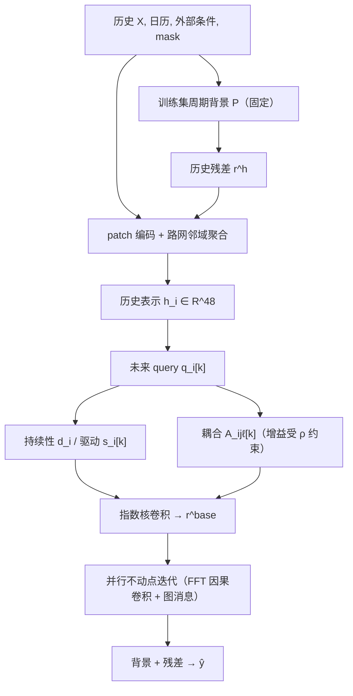

# DeCoDy（Delay-Coupled Neural Dynamics）

DeCoDy 是匿名投稿（ICLR 2027，under review）的多日城市交通演化预测框架，自述为「graph dynamics framework with time delays」：用带时间延迟的图动力学刻画未来残差的演化，由受约束的全 horizon 求解器一次性给出 8 小时至 7 天轨迹（§1、§3）[^src-decody-iclr2027]。16 个 dataset–horizon setting 中，摘要报告 MAE 最低 14 个、7 天在四个数据集上 RMSE 最低（§4.2，Table 1）[^src-decody-iclr2027]。

## 问题定位

三个数据现象界定多日演化（Fig. 1，附录 B）[^src-decody-iclr2027]：

- 同一时段内邻接节点的偏差起始时刻错开、持续时长不同，并在时间上重叠累积（Fig. 1a）；
- 偏差跨午夜延续，节点间滞后相关随日内阶段变化（Fig. 1b）；
- 不同日期共享整体日 profile，局部峰谷幅度差异明显（Fig. 1c）。

对应三项要求：多延迟交互及其时间累积、跨相位与跨天的时变依赖与状态连续性、全局周期结构与局部峰谷的联合表示（§1）[^src-decody-iclr2027]。

## 机制

三个模块加一个求解器，输出节点持续性 $d_i$、时变局部驱动 $s_i[k]$ 与逐时步逐延迟的耦合 $A_{ij\ell}[k]$：

| 模块 | 作用 | 落点 |
|---|---|---|
| Global and Local Residual Representation | 训练集估计的[[shrinkage-periodic-background|周期背景]]，历史与未来残差相对背景表示 | 式(1)–(4) |
| Phase Evolution and Adaptive Coupling | 由历史状态、已知未来日历、背景形状生成 $q_i[k]$、$d_i$、$s_i[k]$、$A_{ij\ell}[k]$ | 式(5)–(7) |
| Multi-Delay Interaction and Accumulation | 自状态持续、局部驱动、延迟邻居影响三项合成残差递推 | [[multi-delay-coupled-accumulation|式(9)–(10)]] |
| constrained full-horizon response solver | 并行不动点迭代求全 horizon 线性系统的解 | [[constrained-full-horizon-response-solver|式(11)–(14)]] |

## 数据流与维度

**维度符号**：$N$ 节点数；$L$ 历史长度（8 h 任务 $L=96$，其余 $L=288$）；$H$ 预测步数（96/288/864/2016）；$K=|\mathcal D|=5$ 延迟档数；$E$ 有效有向边数；$d=48$ 历史表示维；$r=16$ future query 维。形状记作 $[\text{行}, \text{列}]$，按「时间 × 节点」书写[^src-decody-iclr2027]。

### Stage 1 · 估计周期背景，切出历史残差

$$\begin{aligned}
P_i(\tau) &= \alpha_{i,\tau}\,\mu^{week}_{i,\tau} + (1-\alpha_{i,\tau})\,\mu^{day}_{i,\tau \bmod 288},\qquad \alpha_{i,\tau}=\frac{n_{i,\tau}}{n_{i,\tau}+\lambda} && \text{// } [2016, N]\ \text{——每周槽与对应日槽的训练均值按有效观测数 } n_{i,\tau} \text{ 收缩混合}\\
r^{h}_i[t] &= x_i[t]-P_i(\tau(t)),\quad t=1-L,\dots,0 && \text{// } [L, \bcancel{N}]\ \text{逐节点相减}\to[L, N]\ \text{——历史残差，兼作后续动力学的历史边界}
\end{aligned}$$

背景只用训练段估计并固定；周槽统计缺失时依次回退到日槽、节点均值、全局均值（§3.1、§G.2）[^src-decody-iclr2027]。

### Stage 2 · 编码历史条件

$$\begin{aligned}
e_i &= \operatorname{Enc}\big([x^{(p)}_i, r^{h(p)}_i, m^{(p)}_i, c^{h(p)}_i]_{\text{patch}}\big) && \text{// } [L]\ \xrightarrow{\text{切 patch，长 6 步}} [\tfrac{L}{6}\ \text{个 patch 嵌入}]\to\mathbb{R}^{d}\\
g_i &= \mathrm{LN}\Big(e_i + \phi\big(W_g\,[\,e_i,\ \textstyle\sum_{j\in\mathcal N_i}\bar w_{ji}e_j\,]+b_g\big)\Big) && \text{// } [\bcancel{|\mathcal N_i|}, d] \xrightarrow{\text{沿邻域按 } \bar w_{ji} \text{ 求和}} [d]\ \text{——一跳路网聚合，再与自身拼接}\\
h_i &= \mathrm{LN}\big(g_i+\sigma(\beta_w)e^{w}_i+\sigma(\beta_a)e^{a}_i\big) && \text{// } \mathbb{R}^{d}\to\mathbb{R}^{48}\ \text{——天气与事件编码按可学习门控并入}
\end{aligned}$$

### Stage 3 · 由未来条件生成三个驱动量

$$\begin{aligned}
q_i[k] &= \phi\big(W_h h_i + W_c[c[k],\,k/H] + W_p[P^{f}_i[k],\,P^{f}_i[k]-P^{f}_i[k-1]] + b_q\big) && \text{// } [N, \bcancel{48}]\times[\bcancel{48}, 16]\xrightarrow{\text{逐 } k=1..H} [H, N, 16]\ \text{——每个未来步一个 query}\\
d_i &= \operatorname{softplus}(w_d^\top h_i+b_d)+\epsilon && \text{// } [N, \bcancel{48}]\times[\bcancel{48}]\to[N]\ \text{——节点持续性，horizon 内固定}\\
s_i[k] &= d_i\,(w_s^\top q_i[k]+b_s) && \text{// } [H, N, \bcancel{16}]\times[\bcancel{16}]\to[H, N]\ \text{——时变局部驱动}\\
\tilde A_{ij\ell}[k] &= B_{ij\ell}+\eta\tanh\big(W_r q_i[k]+W_s q_j[k]+W_e w_{ji}+b_e\big)_\ell && \text{// } \to[E, K, H]\ \text{——每条有向边、每个延迟档一个原始耦合}\\
A_{ij\ell}[k] &= \frac{\gamma_i\,\tilde A_{ij\ell}[k]}{1+\sum_{j'\in\mathcal N_i}\sum_{\ell'\in\mathcal D}|\tilde A_{ij'\ell'}[k]|},\quad \gamma_i=\rho\,d_i\,\sigma(w_\gamma^\top h_i+b_\gamma) && \text{// } [E, K, H] \xrightarrow{\text{按目标节点 } i \text{ 对入边 } \times \text{ 延迟取绝对值和归一}} [E, K, H]\ \text{——行增益压到 } \rho
\end{aligned}$$

$B_{ij\ell}$ 用训练段滞后相关初始化：$B^{(0)}_{ij\ell}=0.1\,w_{ji}\operatorname{Corr}(r_j[t-\ell], r_i[t])$，有效对少于 3 个或分母近零的项置 0，之后可学习；图取无向并集（双向取最大权重）再展开为两条有向边，论文声明这两条方向不代表真实行驶方向（§G.1）[^src-decody-iclr2027]。

### Stage 4 · 把自回归部分折叠成指数核卷积

$d_i$ 在 horizon 内固定，式(9)的自回归项因此可解析求和。$a_i=e^{-d_i}$、$b_i=(1-e^{-d_i})/d_i$ 与单位步长零阶保持的系数同形，论文未给连续时间方程，此处按系数形状标注[INFERENCE]。

$$\begin{aligned}
(\mathcal H_i f_i)[k] &= \sum_{u=1}^{k} b_i\,a_i^{\,k-u}f_i[u] && \text{// } [H]\ \text{与长度 } H \text{ 的因果核逐节点卷积}\to[H]\ \text{——零填充 FFT，FFT 长度取 } \ge 2H-1 \text{ 的最小 2 的幂}\\
r^{base}_i[k] &= a_i^{k}r_i[0] + \mathcal H_i\big(s_i+m^{hist}_i\big)[k] && \text{// } [H, N]\ \text{——不含未来耦合的 base 轨迹，} m^{hist}_i \text{ 是跨历史边界的延迟消息}
\end{aligned}$$

### Stage 5 · 全 horizon 并行求解

$$\begin{aligned}
r &= r^{base}+\mathcal K(r),\qquad \mathcal K=\mathcal H\circ\mathcal M && \text{// } [H, N]\to[H, N]\ \text{——未来轨迹之间的延迟交互并入同一线性系统}\\
r^{(m+1)} &= r^{base}+\mathcal K\big(r^{(m)}\big),\quad r^{(0)}=r^{base} && \text{// } [H, N]\ \text{的 } H \text{ 个未来位置同时更新}\\
r^{\star} &= \sum_{p=0}^{Q-1}\mathcal K^{p} r^{base},\quad Q=\left\lceil H/\ell_{\min}\right\rceil && \text{// } \text{正延迟使 } \mathcal K^{Q}=0\ \text{——精确解是有限 Neumann 级数，不是无穷迭代}
\end{aligned}$$

停止判据、收敛界与实测耗时见 [[constrained-full-horizon-response-solver]]。

### Stage 6 · 还原为流量并取损失

$$\begin{aligned}
\hat y_i[k] &= \max\{0,\ \sigma_x(P^{f}_i[k]+r_i[k])+\mu_x\} && \text{// } [H, N]\ \text{——背景加残差，按训练集统计反标准化并截断非负}\\
\mathcal L &= \frac{\sum_{n,i,k}M_{n,i,k}\,|\hat y_{n,i}[k]-y_{n,i}[k]|}{\sum_{n,i,k}M_{n,i,k}} && \text{// } \text{masked MAE，在原始流量单位；梯度穿过实际执行的迭代}
\end{aligned}$$

## 关键结果

每个 dataset × horizon 单独训练一个模型（seed 42），$L$ 在 8 h 取 96、其余取 288（§4.1、§A.4）[^src-decody-iclr2027]。与最强基线的对比（MAE / RMSE，Table 1）[^src-decody-iclr2027]：

| 数据集（节点数） | 8 h | 1 d | 3 d | 7 d |
|---|---|---|---|---|
| PEMS04 (266) | 25.11 / 40.52 vs 25.36 / 40.43（Extralonger） | 26.71 / 44.27 vs 27.16 / 43.89（FaST） | 27.20 / 45.45 vs 28.11 / 45.26（Extralonger） | 26.77 / 44.16 vs 29.38 / 47.06（FaST） |
| PEMS08 (112) | 22.42 / 35.06 vs 22.78 / 35.40（Extralonger） | 23.15 / 36.22 vs 23.34 / 36.01（FaST；RMSE 最优为 STID 35.85） | 24.74 / 38.46 vs 24.99 / 38.29（FaST） | 23.94 / 37.70 vs 25.50 / 39.28（FaST） |
| SD (673) | 22.09 / 34.52 vs 26.25 / 40.11（STID） | 23.05 / 35.92 vs 22.87 / 36.65（Extralonger） | 24.23 / 37.72 vs 26.10 / 40.34（Extralonger） | 24.96 / 38.62 vs 24.60 / 38.77（CycleNet） |
| Seattle (196) | 8.33 / 13.67 vs 9.05 / 14.00（STID） | 8.89 / 14.90 vs 9.12 / 14.99（Extralonger） | 9.33 / 15.76 vs 10.23 / 16.25（STID） | 9.63 / 16.46 vs 10.68 / 17.04（STID） |

逐行核对：MAE 最低 14 个 setting，SD 的 1 d 与 7 d 落后，与 §4.2 正文和摘要同口径[^src-decody-iclr2027]。RMSE 的正文写「lowest RMSE in 9 settings」，按 Table 1 逐格计数为 10 个，两处不一致，按表格记录（§4.2）[^src-decody-iclr2027]。

消融（Table 2，3 数据集 × 4 horizon）的五个变体——去周期背景 C-PB、固定未来耦合 C-SC、去未来跨节点耦合 C-FGC、只留单一 5 min 延迟 C-SD、去天气与事件编码 C-EI——在 12 个 setting 上 MAE 与 RMSE 均高于完整模型，多数差距在 0.1–1% 量级，最小为 PEMS04-8h 的 25.109 对 C-EI 25.119；论文另报告 7 d 时 C-SD 在 Seattle 的 MAE 上升 9.86%（§4.3）[^src-decody-iclr2027]。

超参敏感性只覆盖耦合增益上界 $\rho\in\{0.2,0.4,0.6,0.8,0.9\}$ 与背景收缩强度 $\lambda\in\{1,2.5,5,7.5,10\}$：PEMS08 的误差在 $\rho=0.8$ 最低、$\rho=0.9$ 回升，$\lambda=5$ 最优，Seattle 对两者不敏感（§4.4；Fig. 4 只有曲线，无表格数值）[^src-decody-iclr2027]。

## 边界

- **可比性**：PEMS04 与 PEMS08 用筛选后的节点子集（266 / 112），附录 A.1 声明不能与全节点版本的已发表数值直接比较[^src-decody-iclr2027]。
- **归因混杂**：DeCoDy 额外输入历史天气与事件，基线保留各自原生输入配置，附录 A.3 自述主表无法把增益分离到架构与外部信息；外部条件为回溯记录，Seattle 的事件上下文只覆盖 500 m（§A.2）[^src-decody-iclr2027]。
- **统计强度**：单种子（42），作者声明不支持跨种子显著性检验（§A.4）[^src-decody-iclr2027]。
- **效率**：无参数量、训练时长、端到端推理时延，也无与基线的效率对比；附录 E 的计时只比较同一方程的并行与串行求解[^src-decody-iclr2027]。
- **未做**：延迟档数 $K$、回看长度 $L$、深度均无敏感性实验；无缺失率与噪声鲁棒性实验；求解器不收敛的发生频率未报告（全文未提）[^src-decody-iclr2027]。
- **基线缺口**：延迟建模路线上的 PDFormer 出现在 References 但不在基线集内，论文未解释取舍[^src-pdformer-jiang-2023][^src-decody-iclr2027]。

[^src-decody-iclr2027]: [[source-decody-iclr2027]]
[^src-pdformer-jiang-2023]: [[source-pdformer-jiang-2023]]
