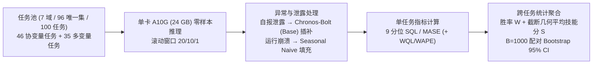

# fev-bench

**fev-bench** 是一套面向真实世界时间序列预测的统一零样本评测基准[^src-fev-bench]。现有公开基准往往领域覆盖偏窄、丢弃了真实业务场景普遍携带的外生协变量（如 M5 与 Rossmann 等零售与运营数据中的促销、价格和日历信息），且仅凭均值或平均排名对比模型，缺乏统计显著性检验，难以区分真实能力提升与任务抽样噪声[^src-fev-bench]。针对这些失真，fev-bench 将评测规模扩充至 7 大领域、96 个唯一数据集共 100 项任务，把已知动态、历史动态和静态三类协变量与多变量任务纳入统一评测流程，并辅以任务级配对 Bootstrap 95% 置信区间与自报泄露分数插补来保证排序可信度[^src-fev-bench]。该基准的核心实证发现表明：当代时间序列基础模型拉开差距的关键在于吃进外生协变量，而仅靠原生多变量交互带来的增益十分有限[^src-fev-bench]。

## 问题定位：协变量缺失与排序失真

既有时间序列基础模型评测长期存在两类盲区，导致模型真实部署价值难以被准确刻画[^src-fev-bench]：

1. **丢弃现实协变量与窄域偏置**：以 GIFT-Eval 为代表的常规零样本基准在标准化清洗过程中常剥离外生特征，使原本带有丰富定价、促销、气象或结构属性的任务退化为纯单变量预测，从而无法检验基础模型处理异构上下文的真实能力[^src-fev-bench]。
2. **排序聚合缺少显著性检验与泄露治理**：当基准包含数十至上百项任务时，简单的平均误差或平均名次对任务抽样与异常值极为敏感，往往把随机波动包装成名次先后；同时，不同模型在预训练阶段对公开数据集存在程度不一的重叠记忆，若不做泄露隔离或统一插补，便无法在同一把尺子上比较零样本泛化能力[^src-fev-bench]。

## 任务构成与统计评测协议

fev-bench 的任务池与统计聚合协议围绕「协变量完备性」和「统计可比性」两项原则构建[^src-fev-bench]：

- **任务池与领域覆盖**：共收录来自 7 大领域的 96 个唯一数据集、拆分为 100 项独立预测任务（每数据集按序列数量设置 20、10 或 1 个滚动评估窗口）；其中 **46 项任务包含协变量**（30 项含已知动态协变量、24 项含历史动态协变量、19 项含静态协变量，三类存在交集），另有 **35 项多变量任务**；针对计算受限场景还单独划分出 20 项任务的轻量子集 `fev-bench-mini`[^src-fev-bench]。
- **受控消融切片**：为把「模型骨干升级」与「吃进协变量」解耦，基准专门在 42 项含动态协变量的共同任务上设置协变量开关消融，并在 35 项多变量任务上对比单变量独立模式与原生多变量模式[^src-fev-bench]。
- **评估指标与聚合规则**：点预测主指标采用 MASE，概率预测主指标采用 9 分位点 Scaled Quantile Loss（SQL，$Q=\{0.1,\dots,0.9\}$，按季节朴素基线误差归一化），并辅报 WQL 与 WAPE[^src-fev-bench]。跨任务聚合时，同时计算边际/成对胜率 $W$ 与相对误差几何平均技能分 $S$（单任务相对误差截断在 $[10^{-2}, 100]$ 区间内以防极端值主导），并以 $B=1000$ 次任务级配对 Bootstrap 估计 95% 置信区间[^src-fev-bench]。
- **自报泄露与崩溃任务插补**：对于模型方自报存在预训练重叠的泄露任务，统一以 `Chronos-Bolt (Base)` 的对应分数进行插补替换；对于因显存或接口限制运行失败的崩溃任务，则统一以 `Seasonal Naive` 分数填充[^src-fev-bench]。

## 与既有工作的关系

在时间序列评测谱系与协变量基础模型研究中，fev-bench 承担「协变量与多变量零样本验收尺」的角色：

- **瓶颈接力 $\Delta$（vs [[probts|ProbTS]]）**：[[probts|ProbTS]]（NeurIPS 2024）打通了无协变量场景下短程概率预测（CRPS）与长程点预测（MASE）的统一评估，并利用趋势、季节性与非高斯性解释 AR/NAR 模型分化[^src-probts]；fev-bench 则把评估瓶颈接力推进到现实外生协变量（已知动态、历史动态、静态）与多变量交互，补充了任务级配对 Bootstrap 置信区间与自报泄露插补机制[^src-fev-bench]。
- **同槽位防泄露路线互斥（vs [[timesx|TimesX]]）**：两者都针对预训练泄露扭曲评测排序的问题提出对策，但路线互斥——[[timesx|TimesX]] 面向多模态真实时钟事件，采用模型知识截断日期（`cutoff >= 2024-07-01`）与四步在线核查做严格时间隔离[^src-timesx]；fev-bench 面向常规数值协变量预测，采用「模型方自报训练重叠 + 基线分数插补」的务实协议，未设立强制前瞻盲测时间窗[^src-fev-bench]。
- **零样本协变量验收与子集复现（vs [[tsfm-covariate-adaptation-comparison|TSFM 协变量适配对比]] 与 [[baguan-ts|Baguan-TS]]）**：为前置/后置协变量适配器与原生 ICL 模型提供了统一量化坐标系；[[baguan-ts|Baguan-TS]] 即取其中 30 项含协变量任务组成 `fev-bench-cov` 子集，与 [[tabpfn-ts|TabPFN-TS]]、[[timesfm|TimesFM-2.5]]、[[chronos|Chronos]] 及 [[tirex|TiRex]] 同台对比点精度与概率校准[^src-baguan-ts]。
- **跨模型实证对齐（vs [[chronos|Chronos]] / [[tabpfn-ts|TabPFN-TS]] / [[tirex|TiRex]] / [[timesfm|TimesFM]]）**：统一评测揭示动态协变量是拉升 Chronos-2 与 TabPFN-TS 表现的核心杠杆，同时也用 95% CI 显式暴露出 TiRex 与 TimesFM-2.5 在第二梯队上的统计不可分性[^src-fev-bench]。

| 基准 | 任务与模态覆盖 | 协变量 / 多变量支持 | 防泄露机制 | 排序聚合与显著性 |
|---|---|---|---|---|
| [[probts\|ProbTS]] | 短/长程单变量与多变量常规集[^src-probts] | 不重点覆盖外生协变量[^src-probts] | 常规公开划分[^src-probts] | 点/分布均值指标对比（无任务级 CI）[^src-probts] |
| [[timesx\|TimesX]] | 19 域 190 条日/周频单变量 + 文本事件[^src-timesx] | 同域协变量摘要、日历与核查事件[^src-timesx] | 严格 cutoff 时间隔离（2024-07-01）[^src-timesx] | 几何均值 MASE，按截止前后对比泄露[^src-timesx] |
| **GIFT-Eval**（论文对照） | 多域单/多变量零样本常规集[^src-fev-bench] | 清洗时丢弃 M5/Rossmann 等外生协变量[^src-fev-bench] | 自报重叠剔除或常规报告[^src-fev-bench] | 均值/排名聚合，缺配对显著性区间[^src-fev-bench] |
| **fev-bench** | 7 域 96 唯一集 / 100 任务[^src-fev-bench] | 46 协变量（30 已知/24 历史/19 静态）+ 35 多变量[^src-fev-bench] | 自报训练重叠 + Chronos-Bolt (Base) 插补[^src-fev-bench] | 胜率 $W$ + 截断几何平均 $S$ + $B=1000$ Bootstrap 95% CI[^src-fev-bench] |

## 证据

论文在 100 项主任务及 42 项动态协变量开关、35 项多变量开关受控消融上报告了如下实证结果（均采用论文报告口径）[^src-fev-bench]：

1. **定位与主结论**：Chronos-2 在 SQL 与 MASE 两项主指标上双项居首；而 **[[tirex|TiRex]] 与 [[timesfm|TimesFM-2.5]] 的 95% 置信区间大幅重叠，第二名在统计上不可区分**；按领域或频率重新加权、或剔除 10 个自报泄露任务后，头部主排序保持稳定[^src-fev-bench]。
2. **真实涨点归因**：在 42 项动态协变量任务上引入协变量，将 Chronos-2 的 SQL 技能分从 $40.9$ 提至 $47.0$、[[tabpfn-ts|TabPFN-TS]] 从 $34.1$ 提至 $42.5$；而在 35 项多变量任务上开启原生多变量模式，Chronos-2 仅从 $54.4$ 微升至 $55.0$、Toto-1.0 从 $54.1$ 微升至 $54.7$，证实当前增益主源在于协变量而非原生多变量自交互[^src-fev-bench]。
3. **证据缺口与负结果**：基准排除了亚分钟级高频序列；属于静态公开基准而非完全盲测的前瞻平台，泄露检测依赖模型方自报；各领域与采样频率下的任务分布并不均衡，且全部模型运行均受单卡 A10G 24 GB 显存限制[^src-fev-bench]。

## 相关页面

- [[source-fev-bench]] — 论文源摘要
- [[probts]] — 前序统一点/分布预测基准（瓶颈接力 $\Delta$）
- [[timesx]] — 严格时间截断防泄露的多模态评测基准（防泄露路线互斥）
- [[tsfm-covariate-adaptation-comparison]] — TSFM 协变量适配与原生路线全景对比
- [[baguan-ts]] — 基于 `fev-bench-cov` 30 项子集验证的序列原生协变量 ICL 模型
- [[chronos]] / [[tabpfn-ts]] / [[tirex]] / [[timesfm]] — fev-bench 主排行与消融中的核心被测模型

[^src-fev-bench]: [[source-fev-bench]]
[^src-probts]: [[source-probts]]
[^src-timesx]: [[source-timesx]]
[^src-baguan-ts]: [[source-baguan-ts]]
