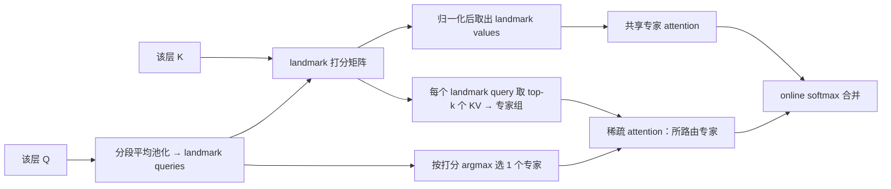

# MiTA Attention

把注意力看成 [[fast-weight-mlp-view-of-attention|fast-weight MLP]] 后，「压缩上下文」与「精确访问原始 KV」是一对矛盾：全量压缩便宜但丢细节，纯路由保留细节但没有全局概括。MiTA（Mixture of Top-$k$ Activations）两者都要——先用少量 landmark query 把全部 KV 池化成几个共享摘要，再让每个 query 按打分挑一个由 top-$k$ 个 key-value 组成的[[deformable-fast-weight-experts|形变专家]]，两条支路最后拼进同一个 softmax[^src-2602-01219-mita]。

## 问题定位

full attention 等价于宽度为 $N$ 的两层 fast-weight MLP：上下文越长，这层 MLP 越宽，单 query 开销随 $N$ 线性增加、全序列复杂度为 $\mathcal{O}(N^2)$（§3.1）[^src-2602-01219-mita]。现有方案各存局限：单纯压缩（Agent attention、Linformer、线性注意力）丧失对原始 KV 的精确访问，单纯路由（MoBA、Deformable DETR、Spark、DSA）缺乏全局上下文概括（§1）[^src-2602-01219-mita]。

## 机制

记 $Q,K,V\in\mathbb{R}^{d\times N}$，landmark query 数 $m\ll N$，专家宽度 $k$，每 query 路由的专家数 $s$。

**一步打分，三处复用**：landmark 与全部 key 的一次打分 $S^{kv}=K^{\top}\tilde Q/\sqrt d$ 同时供 top-$k$ 选取、共享专家分母计算及路由 logits 使用（Algorithm 1 第 2 行，式 7–9）[^src-2602-01219-mita]。

| 部件 | 公式 | 作用 |
|---|---|---|
| landmark query | $\tilde Q=\operatorname{AdaptiveAvgPool}(Q,m)$ | 对 $Q$ 做均匀分段的平均池化，$m$ 个探测向量 |
| 形变专家 | $\mathcal{E}_i(q)=\operatorname{SDPA}(q,K^{(i)},V^{(i)})$，$K^{(i)}=K_{:,\mathcal{I}_i}$，$\mathcal{I}_i=\operatorname{Top}_k(K^{\top}\tilde q_i)$ | $m$ 个宽度恒为 $k$ 的专家组 |
| 共享专家 | $\tilde V=V\operatorname{softmax}(S^{kv})$，$\tilde{\mathcal E}(q)=\operatorname{SDPA}(q,\tilde Q,\tilde V)$ | 常开的全局概括，$m$ 宽 |
| 路由 | $e_1(q)=\arg\max_i (q^{\top}\tilde q_i)$ | 每个 query 选 1 个专家 |
| 合并 | $K^{\star}=[\,\tilde Q,\;K^{(e_1(q))}\,]$，$V^{\star}=[\,\tilde V,\;V^{(e_1(q))}\,]$，$\operatorname{MiTA}(q)=V^{\star}\operatorname{softmax}({K^{\star}}^{\top}q/\sqrt d)$ | 一次 attention，$m+ks$ 对 KV |

默认设置 $m=k=25$、$s=1$，各 query 仅计算 50 对 KV；全部专家覆盖的不同 KV 上限为 $m\times k=625$，已超过 ImageNet-1K 的典型序列长度（§4.1）[^src-2602-01219-mita]。

实现要点：query 依据目标专家排序，将 $m$ 段长度为 $k$ 的 KV 视为独立序列，利用 `cu_seqlens_k = [0,k,2k,…,mk]` 通过变长 FlashAttention 单次完成计算，最后与共享专家输出按 online softmax 合并（Algorithm 1）[^src-2602-01219-mita]。

**替换位置**：直接替代 Transformer 块内 self-attention 算子，$Q,K,V$ 沿用原层线性投影；无额外路由网络，未引入辅助损失或负载均衡损失（§3.2、§4 全文未提）[^src-2602-01219-mita]。

**共享专家的来源**：landmark value 的取法与共享专家的调用形式都与 Agent attention 的两段同型。Agent attention 的 agent aggregation 为 $\sigma(AK^{\top}+B_1)V$、agent broadcast 为 $\sigma(QA^{\top}+B_2)V^{A}$，agent token 取 $A=\operatorname{Pooling}(Q)$[^src-2312-08874-agent-attention]；MiTA 的 $\tilde V=V\operatorname{softmax}(K^{\top}\tilde Q/\sqrt d)$ 与 $O^{\rm share}=\operatorname{FlashAttention}(Q,\tilde Q,\tilde V)$ 是同一对式子，差别在 $\tilde Q=\operatorname{AdaptiveAvgPool}(Q,m)$ 用固定段数的池化，且 MiTA 另建 top-$k$ 形变专家与路由[^src-2602-01219-mita]。MiTA 的分类表把 Agent attention 与其自身同记为 landmark testing，区别落在专家数量（1 vs $m$）与路由拓扑（all-to-one vs $N$-to-$m$）两维（式 3、式 6；Algorithm 1 第 9、11 行；Table 1）[^src-2602-01219-mita]。

## 数据流与维度

形状记作 $[\text{行}, \text{列}]$，与论文记号一致。**维度符号**：$N$ 为序列长度（token 数）；$d$ 为单头通道维；$m$ 为 landmark query 数（默认 25）；$k$ 为每个专家选中的 KV 数（默认 25）；$s$ 为每 query 路由的专家数（默认 1）；$n_i$ 为归入专家 $i$ 的 query 数，满足 $\sum_i n_i=N$。论文按单头形式书写，多头在 batch 维展开为本页推断[^src-2602-01219-mita][INFERENCE]。

### Stage 1 · 造 landmark query

$$\begin{aligned}
\tilde{Q} &= \operatorname{AdaptiveAvgPool}(Q,\ \text{output\_size}=m) && \text{// } [d, N] \xrightarrow{\text{沿 } N \text{ 维均分 } m \text{ 段取均值}} [d, m]\ \text{——} N \text{ 个 query 压成 } m \text{ 个探测向量}
\end{aligned}$$

### Stage 2 · 一次打分，造出两组 KV 视图

$$\begin{aligned}
S^{kv} &= K^{\top}\tilde{Q}/\sqrt{d} && \text{// } [N, \bcancel{d}]\times[\bcancel{d}, m]\to[N, m]\ \text{——消去 } d\text{，每列是一个 landmark 对全部 } N \text{ 个 key 的打分}\\
\mathcal{I}_i &= \operatorname{Top}_k\!\left(K^{\top}\tilde{q}_i\right) && \text{// } [N, m] \xrightarrow{\text{沿 } N \text{ 维逐列 Top-}k} [k, m]\ \text{——每组 } k \text{ 个 key 下标（取值 } 1..N\text{）}\\
K^{\mathrm{expt}}, V^{\mathrm{expt}} &= K[:,\mathcal{I}^{kv}],\ V[:,\mathcal{I}^{kv}] && \text{// } [d, N] \xrightarrow{\text{按 } \mathcal{I}^{kv}\in[mk] \text{ 索引列}} [d, mk]\ \text{——专家 } i \text{ 占槽位 } [ik,(i+1)k)
\end{aligned}$$

索引可重复且 $mk$ 可大于 $N$：同一个 key 能进入多个专家，并集上限为 $\min(mk, N)$。

### Stage 3 · 两条支路并行

**支路 A：共享专家（常开，宽 $m$）**

$$\begin{aligned}
\tilde{V} &= V\operatorname{softmax}\!\left(S^{kv}\right) && \text{// } [d, \bcancel{N}]\times[N, m] \xrightarrow{\text{softmax 沿 } N} [d, m]\ \text{——全部 value 加权成 } m \text{ 个摘要}\\
A^{\mathrm{share}} &= \operatorname{softmax}\!\left(\tilde{Q}^{\top}Q/\sqrt{d}\right) && \text{// } [m, \bcancel{d}]\times[\bcancel{d}, N]\to[m, N] \xrightarrow{\text{softmax 沿 } m} [m, N]\\
O^{\mathrm{share}} &= \tilde{V}A^{\mathrm{share}} && \text{// } [d, \bcancel{m}]\times[\bcancel{m}, N]\to[d, N]\ \text{——每 query 只对 } m \text{ 对 KV}
\end{aligned}$$

**支路 B：形变专家（稀疏，宽 $k$）**。记 $Q^{(i)}\in[d, n_i]$ 为按 $\mathcal{I}^{\mathrm{expt}}$ 归入专家 $i$ 的 query 列，$V^{(i)},K^{(i)}\in[d,k]$ 为其对应的 top-$k$ KV。

$$\begin{aligned}
R &= \tilde{Q}^{\top}Q && \text{// } [m, \bcancel{d}]\times[\bcancel{d}, N]\to[m, N]\ \text{——与 } S^{kv} \text{ 同型，只把 } K \text{ 换成 } Q\\
e_1 &= \operatorname{ArgMax}_{m} R && \text{// } [m, N] \xrightarrow{\text{沿 } m \text{ 维 ArgMax}} [N]\ \text{——每 query 一个专家编号}\\
\mathcal{I}^{\mathrm{expt}} &= \operatorname{ArgSort}(e_1) && \text{// } [N] \xrightarrow{\text{按编号排序}} [N]\ \text{——只重排 query 的列序，不改数值}\\
A^{(i)} &= \operatorname{softmax}\!\left(K^{(i)\top}Q^{(i)}/\sqrt{d}\right) && \text{// } [k, \bcancel{d}]\times[\bcancel{d}, n_i]\to[k, n_i] \xrightarrow{\text{softmax 沿 } k} [k, n_i]\\
O^{(i)} &= V^{(i)}A^{(i)} && \text{// } [d, \bcancel{k}]\times[\bcancel{k}, n_i]\to[d, n_i]\ \text{——只算路由到专家 } i \text{ 的 } n_i \text{ 个 query}
\end{aligned}$$

逐专家循环并非必需：将 $Q$ 按 $\mathcal{I}^{\mathrm{expt}}$ 重排后，以 $\mathrm{cu\_seqlens}_q=\operatorname{CumSum}(\operatorname{BinCount}(e_1))$ 与 $\mathrm{cu\_seqlens}_k=[0,k,2k,\dots,mk]$ 进行单次变长 FlashAttention 计算，第 $i$ 段即 $(Q^{(i)},K^{(i)},V^{(i)})$（Algorithm 1 第 13–14 行）[^src-2602-01219-mita]。

### Stage 4 · 汇合为一次 softmax

$$\begin{aligned}
K^{\star} &= [\,\tilde{Q},\,K^{(e_1)}\,] && \text{// } [d, m]\oplus[d, k]\to[d, m+k]\quad(s>1:\ [d, m+ks])\\
V^{\star} &= [\,\tilde{V},\,V^{(e_1)}\,] && \text{// } [d, m]\oplus[d, k]\to[d, m+k]\\
\Lambda &= K^{\star\top}Q/\sqrt{d} && \text{// } [m{+}k, \bcancel{d}]\times[\bcancel{d}, N]\to[m{+}k, N]\ \text{——前 } m \text{ 行即 } R/\sqrt{d}\\
O &= V^{\star}\operatorname{softmax}(\Lambda) && \text{// } [d, \bcancel{m{+}k}]\times[\bcancel{m{+}k}, N]\to[d, N]\ \text{——全局与局部在同一分母下竞争}
\end{aligned}$$

两条支路若各自归一化后再加权求和会得到不同的权重；论文要求拼接后统一做一次 softmax（式 10）。实际实现中，分专家计算后通过 online softmax（LSE）合并 $O^{\mathrm{share}}$ 与 $O^{\mathrm{expt}}$，与该式等值（§3.2）[^src-2602-01219-mita]。

### 结构要点

- **key 侧宽度与 $N$ 无关**：注意力计算中 key 侧固定为 $m+ks$；$N$ 只出现在 query 侧，以及池化、$S^{kv}/R$ 打分、gather 索引范围这三处对 $N$ 的读取中。
- **路由是 $N\to m\to N$ 的往返**：$R$ 沿 $m$ 取 argmax 得到 $N$ 个编号（归类），再按编号将 $N$ 个 query 分发到 $m$ 段变长序列中（展开）；该过程只改变排列而不产生新表示，目的是把 $m$ 个专家合并为一次调用。
- **路由分数就是共享专家的 logits**：$R$ 与 $S^{kv}$ 同型，只差 $K\leftrightarrow Q$ 与 $1/\sqrt{d}$；由于共享专家的 key 即 $\tilde{Q}$，$\Lambda$ 的前 $m$ 行恰为 $R_{:,q}/\sqrt{d}$，因此路由是本次 attention 的前缀而非独立模块（式 10）[^src-2602-01219-mita]。
- **换算**：$m=k=25$、$s=1$ 时单 query 只算 50 对 KV，专家矩阵为 $d\times 625$；ADE20K 的 $512\times512$ 输入对应 $N=1024$，$36+36$ 配置下单 query 算 72 对、并集上限 $36\times36=1296>N$（Table 4）[^src-2602-01219-mita]。

## 复杂度

合并后的单次 attention 计算量是 $\mathcal{O}\!\left(N(m+ks)\right)$，相对 full attention 的 $\mathcal{O}(N^2)$ 只有在 $N\gg m+ks$ 时才算省（式 10，§3.2）[^src-2602-01219-mita]。上界只覆盖这一步：$\mathcal{O}(Nm)$ 打分、$\mathcal{O}(Nm)$ landmark value 提取与 gather 访存均未计入，且未给出空间复杂度。论文将 gather 随机访存列为潜在显存带宽瓶颈，所引 DSA 缓解方案未经验证[^src-2602-01219-mita]。

## 与 NSA 的合并口径对照

MiTA 与 [[native-sparse-attention|NSA]] 都把压缩与路由放进同一个 attention，合并方式不同：

| 项目 | MiTA | NSA |
|---|---|---|
| 合并 | $[\tilde Q,\,K^{(e_1)}]$、$[\tilde V,\,V^{(e_1)}]$ 拼接后单次 softmax，全局与局部在同一分母下竞争[^src-2602-01219-mita] | 压缩、块选择、滑动窗口三支路各自 softmax，再按 sigmoid 门控加权求和，门控三个值互不归一[^src-2502-11089-nsa] |
| 支路数 | 2（常开共享专家 + 1 个路由专家） | 3（压缩 + 块选择 + 滑动窗口）[^src-2502-11089-nsa] |
| 打分来源 | landmark query 的 $S^{kv}=K^{\top}\tilde Q$ 同时供 top-$k$ 与路由 | 压缩支路的注意力分数 $p^{cmp}_t=\operatorname{Softmax}(q_t^{\top}\tilde K^{cmp}_t)$ 供 top-$n$ 选块[^src-2502-11089-nsa] |
| 单 query 的 KV 量 | $m+k=50$ 对（$25+25$）[^src-2602-01219-mita] | $\lfloor (s-l)/d\rfloor+nl'+w$，$s=64$k 时为 5632 个等价 token[^src-2502-11089-nsa] |
| 验证域 | ImageNet-1K/21K、ADE20K、LRA，均为视觉任务[^src-2602-01219-mita] | 27B 语言模型预训练、LongBench、AIME 24[^src-2502-11089-nsa] |

表中 MiTA 侧公式号见式 10，NSA 侧见式 5、式 8，KV 量出自 NSA Table 4。两项机制之间没有同台实验：NSA 的稀疏基线是 H2O、InfLLM、Quest、Exact-Top，质量基线是 Full Attention（§4.2）；MiTA 的基线是 ViT、Agent-ViT、Linear-ViT（Table 3）[^src-2502-11089-nsa][^src-2602-01219-mita]。

## 证据

1. **定位：以更小开销逼近 full attention，而非在精度上超越它。** ImageNet-1K 从头训练（Table 2）没有一列属于 MiTA：Tiny 74.8 落后 DeiT-T$^{\triangle}$ 75.8 列第三，Small 79.3 落后 Agent-DeiT-S$^{49,\triangle,\text{Bias}}$ 80.5 列第四；ImageNet-21K 微调（Table 3）四个规格全部第二，落后 ViT 1.3 / 0.3 / 1.6 / 0.4，领先 Agent-ViT$^{64}$ 0.9–1.7；LRA 平均 59.26 对 full attention 59.37，其中 Text −1.78、Retrieval −0.74。开销一侧则很干净：参数与 ViT 相同，MACs 少 0.1–0.2G。ADE20K 分割（Table 4）是全文唯一取得某列最优的表，Tiny 规格 ss/ms 38.8 / 39.6 高于 Seg-T-Mask 的 38.1 / 38.8，参数 6M 对 7M[^src-2602-01219-mita]。
2. **归因：论文没有拆 $m$、$k$、$s$ 的消融。** 机制层面的证据只有两组图：Fig. 8 显示 MiTA checkpoint 迁回 full attention 掉点较小，Fig. 7 显示推理期放大 $(m,k)$ 比缩小更稳，作者据此建议以小 $(m,k)$ 训练、推理时放大。间接线索是 Agent-ViT 把 $m$ 从 49 增到 64 只涨 0.1–0.3，论文据此判断 landmark 压缩路径的收益已饱和。相对 Agent-ViT 的涨点（Tiny 68.9→72.9、Small 76.0→78.5）没有实验拆到共享专家与形变专家各自头上[^src-2602-01219-mita]。
3. **缺口与负结果：** LRA 的文本类任务（Text、Retrieval）落后 full attention，ImageNet-1K/21K 未赢 ViT；§4.1 声明对比 Linear-ViT，Table 2 却没有该行（只在 21K 的 Table 3 出现）；Table 2、4、5 未给输入分辨率、patch 大小、训练 epoch 与优化器；没有 MoBA、NSA、Spark、DSA 等 MoE 与 top-$k$ attention 基线同台；效率只在 RTX 4090 上测到 $2^{20}$ 的合成序列，曲线数值不可读，且 $m\times k\approx N/4$ 指专家并集而非单 query 的 $m+k$ 对；摘要把范围限定为视觉任务，LRA 却含文本任务，两处口径不一致[^src-2602-01219-mita]。

## 相关页面

- [[source-2602-01219-mita]] — 源摘要
- [[fast-weight-mlp-view-of-attention]] — 形式化基础
- [[fast-weight-scaling-taxonomy]] — 五维分类与 MiTA 所在格
- [[deformable-fast-weight-experts]] — 形变专家与「可复用 top-$k$ 集合」
- [[moba-attention]] — 刚性块路由的对照
- [[native-sparse-attention]] — 三分支 + sigmoid 门控的合并口径对照
- [[cbsa]] · [[representative-token-extraction]] — 压缩支的同族机制（Agent attention）
- [[agent-attention]] — 共享专家的直接来源：agent aggregation + broadcast 两段
- [[mixture-of-experts]] — MoE 原则用于 attention

[^src-2602-01219-mita]: [[source-2602-01219-mita]]
[^src-2502-11089-nsa]: [[source-2502-11089-nsa]]
[^src-2312-08874-agent-attention]: [[source-2312-08874-agent-attention]]
