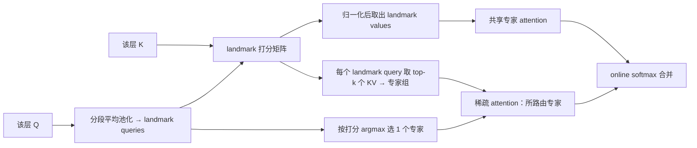

# MiTA Attention

MiTA（Mixture of Top-$k$ Activations）结合 [[fast-weight-mlp-view-of-attention|fast-weight 视角]]下的压缩与路由路径：通过少量 landmark query 将 $N$ 宽 MLP 压缩为紧凑的共享专家，同时为每个 landmark query 聚合 top-$k$ 个 key-value 对构建[[deformable-fast-weight-experts|形变专家]]（arXiv:2602.01219，§3.2）[^src-2602-01219-mita]。

## 问题定位

full attention 等价于宽度为 $N$ 的两层 fast-weight MLP，上下文增长引起宽度线性扩展，单 query 开销随 $N$ 线性增加、全序列复杂度为 $\mathcal{O}(N^2)$（§3.1）[^src-2602-01219-mita]。现有方案各存局限：单纯压缩（Agent attention、Linformer、线性注意力）丧失对原始 KV 的精确访问，单纯路由（MoBA、Deformable DETR、Spark、DSA）缺乏全局上下文概括（§1）[^src-2602-01219-mita]。

## 机制

记 $Q,K,V\in\mathbb{R}^{d\times N}$，landmark query 数 $m\ll N$，专家宽度 $k$，每 query 路由的专家数 $s$。

**一步打分，三处复用**：$S^{kv}=K^{\top}\tilde Q/\sqrt d$（Algorithm 1 第 2 行）同时用于 top-$k$ 选取、共享专家分母计算及路由 logits（式 7–9 合并说明）[^src-2602-01219-mita]。

| 部件 | 公式 | 作用 |
|---|---|---|
| landmark query | $\tilde Q=\operatorname{AdaptiveAvgPool}(Q,m)$ | 对 $Q$ 做均匀分段的平均池化，$m$ 个探测向量 |
| 形变专家 | $\mathcal{E}_i(q)=\operatorname{SDPA}(q,K^{(i)},V^{(i)})$，$K^{(i)}=K_{:,\mathcal{I}_i}$，$\mathcal{I}_i=\operatorname{Top}_k(K^{\top}\tilde q_i)$ | $m$ 个宽度恒为 $k$ 的专家组 |
| landmark value | $\tilde V=V\operatorname{softmax}(S^{kv})$ | 共享专家的 value |
| 共享专家 | $\tilde{\mathcal E}(q)=\operatorname{SDPA}(q,\tilde Q,\tilde V)$ | 常开的全局概括，$m$ 宽 |
| 路由 | $e_1(q)=\arg\max_i (q^{\top}\tilde q_i)$ | 每个 query 选 1 个专家 |
| 合并 | $K^{\star}=[\,\tilde Q,\;K^{(e_1(q))}\,]$，$V^{\star}=[\,\tilde V,\;V^{(e_1(q))}\,]$，$\operatorname{MiTA}(q)=V^{\star}\operatorname{softmax}({K^{\star}}^{\top}q/\sqrt d)$ | 一次 attention，$m+ks$ 对 KV |

默认设置 $m=k=25$、$s=1$，各 query 仅计算 50 对 KV；全部专家覆盖的不同 KV 上限为 $m\times k=625$（§4.1）[^src-2602-01219-mita]。

实现要点：query 依据目标专家排序，将 $m$ 段长度为 $k$ 的 KV 视为独立序列，利用 `cu_seqlens_k = [0,k,2k,…,mk]` 通过变长 FlashAttention 单次完成计算，最后与共享专家输出按 online softmax 合并（Algorithm 1）[^src-2602-01219-mita]。

**替换位置**：直接替代 Transformer 块内 self-attention 算子，$Q,K,V$ 沿用原层线性投影；无额外路由网络，未引入辅助损失或负载均衡损失（§3.2、§4 全文未提）[^src-2602-01219-mita]。

**共享专家的来源**：landmark value 的取法与共享专家的调用形式与 Agent attention 的两段同型。Agent attention 的 agent aggregation 为 $\sigma(AK^{\top}+B_1)V$、agent broadcast 为 $\sigma(QA^{\top}+B_2)V^{A}$，agent token 取 $A=\operatorname{Pooling}(Q)$（arXiv:2312.08874 式 3、式 6）[^src-2312-08874-agent-attention]；MiTA 的 $\tilde V=V\operatorname{softmax}(K^{\top}\tilde Q/\sqrt d)$ 与 $O^{\rm share}=\operatorname{FlashAttention}(Q,\tilde Q,\tilde V)$ 是同一对式子（Algorithm 1 第 9、11 行），差别在 $\tilde Q=\operatorname{AdaptiveAvgPool}(Q,m)$ 用固定段数的池化、且 MiTA 另建 top-$k$ 形变专家与路由[^src-2602-01219-mita]。MiTA 的分类表把 Agent attention 与其自身同记为 landmark testing，区别落在专家数量（1 vs $m$）与路由拓扑（all-to-one vs $N$-to-$m$）两维（Table 1）[^src-2602-01219-mita]。

## 数据流与维度

形状记作 $[\text{行}, \text{列}]$，与论文记号一致。**维度符号**：$N$ 为序列长度（token 数）；$d$ 为单头通道维；$m$ 为 landmark query 数（默认 25）；$k$ 为每个专家选中的 KV 数（默认 25）；$s$ 为每 query 路由的专家数（默认 1）；$n_i$ 为归入专家 $i$ 的 query 数，满足 $\sum_i n_i=N$。论文按单头形式书写，多头在 batch 维展开为本页推断[^src-2602-01219-mita][INFERENCE]。

### Stage 1 · 造 landmark query

$$\begin{aligned}
\tilde{Q} &= \operatorname{AdaptiveAvgPool}(Q,\ \text{output\_size}=m) && \text{// } [d, N] \xrightarrow{\text{沿 } N \text{ 维均分 } m \text{ 段取均值}} [d, m]\ \text{——} N \text{ 个 query 压成 } m \text{ 个探测向量}
\end{aligned}$$

### Stage 2 · 一次打分，造出两组 KV 视图

$$\begin{aligned}
S^{kv} &= K^{\top}\tilde{Q}/\sqrt{d} && \text{// } [N, \bcancel{d}]\times[\bcancel{d}, m]\to[N, m]\ \text{——消去 } d\text{，每列是一个 landmark 对全部 } N \text{ 个 key 的打分}\\
\mathcal{I}_i &= \operatorname{Top}_k\!\left(K^{\top}\tilde{q}_i\right) && \text{// } [N, m] \xrightarrow{\text{沿 } N \text{ 维逐列 Top-}k} [k, m]\ \text{——每组 } k \text{ 个 key 下标（取值 } 1..N\text{）}\\
K^{\mathrm{expt}}, V^{\mathrm{expt}} &= K[:,\mathcal{I}^{kv}],\ V[:,\mathcal{I}^{kv}] && \text{// } [d, N] \xrightarrow{\text{按 } \mathcal{I}^{kv}\in[mk] \text{ 索引列}} [d, mk]\ \text{——专家 } i \text{ 占槽位 } [ik,(i+1)k)
\end{aligned}$$

索引可重复且 $mk$ 可大于 $N$：同一个 key 能进入多个专家，并集上限为 $\min(mk, N)$。

### Stage 3 · 两条支路并行

**支路 A：共享专家（常开，宽 $m$）**

$$\begin{aligned}
\tilde{V} &= V\operatorname{softmax}\!\left(S^{kv}\right) && \text{// } [d, \bcancel{N}]\times[N, m] \xrightarrow{\text{softmax 沿 } N} [d, m]\ \text{——全部 value 加权成 } m \text{ 个摘要}\\
A^{\mathrm{share}} &= \operatorname{softmax}\!\left(\tilde{Q}^{\top}Q/\sqrt{d}\right) && \text{// } [m, \bcancel{d}]\times[\bcancel{d}, N]\to[m, N] \xrightarrow{\text{softmax 沿 } m} [m, N]\\
O^{\mathrm{share}} &= \tilde{V}A^{\mathrm{share}} && \text{// } [d, \bcancel{m}]\times[\bcancel{m}, N]\to[d, N]\ \text{——每 query 只对 } m \text{ 对 KV}
\end{aligned}$$

**支路 B：形变专家（稀疏，宽 $k$）**。记 $Q^{(i)}\in[d, n_i]$ 为按 $\mathcal{I}^{\mathrm{expt}}$ 归入专家 $i$ 的 query 列，$V^{(i)},K^{(i)}\in[d,k]$ 为其对应的 top-$k$ KV。

$$\begin{aligned}
R &= \tilde{Q}^{\top}Q && \text{// } [m, \bcancel{d}]\times[\bcancel{d}, N]\to[m, N]\ \text{——与 } S^{kv} \text{ 同型，只把 } K \text{ 换成 } Q\\
e_1 &= \operatorname{ArgMax}_{m} R && \text{// } [m, N] \xrightarrow{\text{沿 } m \text{ 维 ArgMax}} [N]\ \text{——每 query 一个专家编号}\\
\mathcal{I}^{\mathrm{expt}} &= \operatorname{ArgSort}(e_1) && \text{// } [N] \xrightarrow{\text{按编号排序}} [N]\ \text{——只重排 query 的列序，不改数值}\\
A^{(i)} &= \operatorname{softmax}\!\left(K^{(i)\top}Q^{(i)}/\sqrt{d}\right) && \text{// } [k, \bcancel{d}]\times[\bcancel{d}, n_i]\to[k, n_i] \xrightarrow{\text{softmax 沿 } k} [k, n_i]\\
O^{(i)} &= V^{(i)}A^{(i)} && \text{// } [d, \bcancel{k}]\times[\bcancel{k}, n_i]\to[d, n_i]\ \text{——只算路由到专家 } i \text{ 的 } n_i \text{ 个 query}
\end{aligned}$$

逐专家循环并非必需：将 $Q$ 按 $\mathcal{I}^{\mathrm{expt}}$ 重排后，以 $\mathrm{cu\_seqlens}_q=\operatorname{CumSum}(\operatorname{BinCount}(e_1))$ 与 $\mathrm{cu\_seqlens}_k=[0,k,2k,\dots,mk]$ 进行单次变长 FlashAttention 计算，第 $i$ 段即 $(Q^{(i)},K^{(i)},V^{(i)})$（Algorithm 1 第 13–14 行）[^src-2602-01219-mita]。

### Stage 4 · 汇合为一次 softmax

$$\begin{aligned}
K^{\star} &= [\,\tilde{Q},\,K^{(e_1)}\,] && \text{// } [d, m]\oplus[d, k]\to[d, m+k]\quad(s>1:\ [d, m+ks])\\
V^{\star} &= [\,\tilde{V},\,V^{(e_1)}\,] && \text{// } [d, m]\oplus[d, k]\to[d, m+k]\\
\Lambda &= K^{\star\top}Q/\sqrt{d} && \text{// } [m{+}k, \bcancel{d}]\times[\bcancel{d}, N]\to[m{+}k, N]\ \text{——前 } m \text{ 行即 } R/\sqrt{d}\\
O &= V^{\star}\operatorname{softmax}(\Lambda) && \text{// } [d, \bcancel{m{+}k}]\times[\bcancel{m{+}k}, N]\to[d, N]\ \text{——全局与局部在同一分母下竞争}
\end{aligned}$$

两条支路若各自归一化后再加权求和会得到不同的权重；式（10）要求拼接后进行单次 softmax。实际实现中，分专家计算后通过 online softmax（LSE）合并 $O^{\mathrm{share}}$ 与 $O^{\mathrm{expt}}$，与该式等值（§3.2）[^src-2602-01219-mita]。

### 结构要点

- **key 侧宽度与 $N$ 无关**：注意力计算中 key 侧固定为 $m+ks$；$N$ 只出现在 query 侧，以及池化、$S^{kv}/R$ 打分、gather 索引范围这三处对 $N$ 的读取中。
- **路由是 $N\to m\to N$ 的往返**：$R$ 沿 $m$ 取 argmax 得到 $N$ 个编号（归类），再按编号将 $N$ 个 query 分发到 $m$ 段变长序列中（展开）；该过程只改变排列而不产生新表示，目的是把 $m$ 个专家合并为一次调用。
- **路由分数就是共享专家的 logits**：$R$ 与 $S^{kv}$ 同型，只差 $K\leftrightarrow Q$ 与 $1/\sqrt{d}$；由于共享专家的 key 即 $\tilde{Q}$，$\Lambda$ 的前 $m$ 行恰为 $R_{:,q}/\sqrt{d}$，因此路由是本次 attention 的前缀而非独立模块（式 10）[^src-2602-01219-mita]。

### 配置换算

$m=k=25$、$s=1$ 时，单 query 计算 50 对 KV，$K^{\mathrm{expt}},V^{\mathrm{expt}}$ 为 $d\times 625$，并集上限 $m\times k=625$ 已超过 ImageNet-1K 的典型序列长度（§4.1）[^src-2602-01219-mita]。在 ADE20K 中，$512\times512$ 输入与 patch 16 对应 $N=1024$，$36+36$ 配置下单 query 计算 72 对 KV，并集上限 $36\times36=1296>N$（Table 4）[^src-2602-01219-mita]。

## 复杂度

式（10）本身是 $\mathcal{O}\!\left(N(m+ks)\right)$，相对 full attention 的 $\mathcal{O}(N^2)$，前提是 $N\gg m+ks$（§3.2）[^src-2602-01219-mita]。上界只覆盖这一步：$\mathcal{O}(Nm)$ 打分、$\mathcal{O}(Nm)$ landmark value 提取与 gather 访存均未计入，且未给出空间复杂度。论文将 gather 随机访存列为潜在显存带宽瓶颈，所引 DSA 缓解方案未经验证[^src-2602-01219-mita]。

## 与 NSA 的合并口径对照

MiTA 与 [[native-sparse-attention|NSA]] 都把压缩与路由放进同一个 attention，合并方式不同：

| 项目 | MiTA | NSA |
|---|---|---|
| 合并 | $[\tilde Q,\,K^{(e_1)}]$、$[\tilde V,\,V^{(e_1)}]$ 拼接后单次 softmax，全局与局部在同一分母下竞争（式 10）[^src-2602-01219-mita] | 压缩、块选择、滑动窗口三支路各自 softmax，再按 sigmoid 门控加权求和，门控三个值互不归一（式 5）[^src-2502-11089-nsa] |
| 支路数 | 2（常开共享专家 + 1 个路由专家） | 3（压缩 + 块选择 + 滑动窗口）[^src-2502-11089-nsa] |
| 打分来源 | landmark query 的 $S^{kv}=K^{\top}\tilde Q$ 同时供 top-$k$ 与路由 | 压缩支路的注意力分数 $p^{cmp}_t=\operatorname{Softmax}(q_t^{\top}\tilde K^{cmp}_t)$ 供 top-$n$ 选块（式 8）[^src-2502-11089-nsa] |
| 单 query 的 KV 量 | $m+k=50$ 对（$25+25$）[^src-2602-01219-mita] | $\lfloor (s-l)/d\rfloor+nl'+w$，$s=64$k 时为 5632 个等价 token（Table 4）[^src-2502-11089-nsa] |
| 验证域 | ImageNet-1K/21K、ADE20K、LRA，均为视觉任务[^src-2602-01219-mita] | 27B 语言模型预训练、LongBench、AIME 24（§4）[^src-2502-11089-nsa] |

两项机制之间没有同台实验：NSA 的稀疏基线是 H2O、InfLLM、Quest、Exact-Top，质量基线是 Full Attention（§4.2）；MiTA 的基线是 ViT、Agent-ViT、Linear-ViT（Table 3）[^src-2502-11089-nsa][^src-2602-01219-mita]。

## 证据

### ImageNet-1K 从头训练（Table 2）

同配方重训与直接引自原论文的行在原文以颜色区分，转换后颜色丢失导致可比行无法核实。$25+25$ 表示 $m+k=25+25$；$\triangle$ 表示 depth-wise convolution，Bias 表示 Agent bias[^src-2602-01219-mita]。

| 方法 | Acc. | MACs | #Params |
|---|---|---|---|
| DeiT-T (2021) | 72.2 | 1.2G | 5.7M |
| FLatten-DeiT-T$^{\triangle}$ (2023) | 74.1 | 1.1G | 6.1M |
| Agent-DeiT-T$^{49,\triangle,\text{Bias}}$ (2024) | 74.9 | 1.2G | 6.0M |
| Agent-ViT-T$^{25}$ | 68.9 | 1.1G | 5.7M |
| Agent-ViT-T$^{49}$ | 71.7 | 1.1G | 5.7M |
| ViT-T | 73.1 | 1.2G | 5.7M |
| DeiT-T$^{\triangle}$ | 75.8 | 1.2G | 5.7M |
| MiTA-ViT-T$^{25+25}$ | 72.9 | 1.1G | 5.7M |
| MiTA-ViT-T$^{25+25,\triangle}$ | 74.8 | 1.1G | 5.7M |
| DeiT-S (2021) | 79.8 | 4.6G | 22.1M |
| Agent-DeiT-S$^{49,\triangle,\text{Bias}}$ (2024) | 80.5 | 4.4G | 22.7M |
| Agent-ViT-S$^{49}$ | 76.0 | 4.4G | 22.1M |
| ViT-S | 77.9 | 4.6G | 22.1M |
| ViT-S$^{\triangle}$ | 79.5 | 4.6G | 22.1M |
| MiTA-ViT-S$^{25+25}$ | 78.5 | 4.4G | 22.1M |
| MiTA-ViT-S$^{25+25,\triangle}$ | 79.3 | 4.4G | 22.1M |

MiTA 在该表中未取得单列最优：Tiny 列最优为 DeiT-T$^{\triangle}$ 75.8、MiTA 74.8 列第三；Small 列最优为 Agent-DeiT-S$^{49,\triangle,\text{Bias}}$ 80.5、MiTA 79.3 列第四。同配置下 MiTA 高于 Agent-ViT（T 68.9→72.9，S 76.0→78.5），相比 ViT 在 ±1 范围内浮动（−0.2 / +0.6），论文表述为与 ViT 持平（on par）。参数量与 ViT 一致，MACs 减少 0.1G / 0.2G[^src-2602-01219-mita]。

Agent-ViT 行（含 Table 3 的 $^{49}$ / $^{64}$ 两档）是 MiTA 论文把 agent attention 套到 plain ViT 后重训的结果。Agent attention 原论文不含 ViT 行，其一手表覆盖 DeiT、PVT、Swin、CSwin 四个骨干，其中 Agent-DeiT-T 为 74.9、Agent-DeiT-S 为 80.5，与本表引用值逐项一致（arXiv:2312.08874 Table 1、Table 13）[^src-2312-08874-agent-attention]。

### ImageNet-21K 预训练权重微调（Table 3）

仅替换 attention、微调 50 epoch 的 top-1 精度（Table 3）[^src-2602-01219-mita]：

| 方法 | Tiny | Small | Base | Large |
|---|---|---|---|---|
| ViT | 76.9 | 81.2 | 84.4 | 85.9 |
| Linear-ViT | 73.2 | 78.6 | 79.8 | 80.7 |
| Agent-ViT$^{49}$ | 74.6 | 79.7 | 81.4 | 83.5 |
| Agent-ViT$^{64}$ | 74.7 | 79.9 | 81.5 | 83.8 |
| MiTA-ViT$^{25+25}$ | 75.6 | 80.9 | 82.8 | 85.5 |

MiTA 在四个规格均列第二，落后 ViT 1.3 / 0.3 / 1.6 / 0.4，领先 Agent-ViT$^{64}$ 0.9 / 1.0 / 1.3 / 1.7。Agent-ViT 将 $m$ 从 49 增至 64 仅提升 0.1–0.3，论文据此推断压缩路径的收益已趋饱和[^src-2602-01219-mita]。

### ADE20K 分割（Table 4）

仅替换 Segmenter 解码器，编码器采用 ImageNet-21K 预训练 ViT，输入尺寸固定 $512\times512$、patch 16，序列长度 1024，MiTA 采用 $36+36$ 配置（Table 4）[^src-2602-01219-mita]：

| 方法 | mIoU (ss/ms) | #Params |
|---|---|---|
| Seg-T-Mask (2021) | 38.1 / 38.8 | 7M |
| Seg-T-MiTA$^{36+36}$ | 38.8 / 39.6 | 6M |
| Seg-S-Mask | 45.3 / 46.9 | 27M |
| Seg-S-MiTA$^{36+36}$ | 45.5 / 46.8 | 24M |
| Seg-B-Mask | 48.8 / 50.0 | 106M |
| Seg-B-MiTA$^{36+36}$ | 48.8 / 49.9 | 96M |

Tiny 规格下 ss 与 ms 均更高（+0.7 / +0.8），Small 规格下 ss +0.2、ms −0.1，Base 规格下 ss 持平、ms −0.1；参数量分别减少 1M / 3M / 10M。这是全文唯一一张 MiTA 取得某列最优的表（Table 4）[^src-2602-01219-mita]。

### Long Range Arena（Table 5）

测试配置 $m=16$、$k=16$；Agent attention 采用 $m=32$；全部方法均不使用 DWC（Table 5）[^src-2602-01219-mita]：

| 方法 | ListOps (2K) | Text (4K) | Retrieval (4K) | Image (1K) | Pathfinder (1K) | Avg |
|---|---|---|---|---|---|---|
| Standard (full attention) | 37.10 | 65.02 | 80.11 | 40.45 | 74.16 | 59.37 |
| Reformer (2020) | 19.05 | 64.88 | 78.64 | 43.29 | 69.36 | 55.04 |
| Linformer (2020) | 37.25 | 55.91 | 79.37 | 37.84 | 67.60 | 55.59 |
| Performer (2021) | 18.80 | 63.81 | 78.62 | 37.07 | 69.87 | 53.63 |
| Nyströmformer (2021) | 18.70 | 65.64 | 80.37 | 39.70 | 73.46 | 55.57 |
| Agent attention (2024) | 37.15 | 64.41 | 79.75 | 38.17 | 72.57 | 58.40 |
| MiTA attention | 37.20 | 63.24 | 79.37 | 42.19 | 74.32 | 59.26 |

MiTA 在 ListOps、Image、Pathfinder 取得最高分，在 Text（−1.78）与 Retrieval（−0.74）落后于 full attention。平均分 59.26 较 full attention 低 0.11、较 Agent attention 高 0.86。核算五项均值：MiTA 为 59.264，full attention 为 59.368，与表中 Avg 数值吻合[^src-2602-01219-mita]。

### 效率（Fig. 6）

在 RTX 4090 24GB 硬件上评测至 $2^{20}$ 序列长度的推理吞吐（samples/s），对照基准为 PyTorch fused kernel 实现的 full attention；测试环境为三层 Transformer、模型维度 128、10K 合成样本；参数设置 $m\times k\approx N/4$，gather 操作未做自定义 CUDA 优化。图表曲线数值无法自本地文本读取（Fig. 6）[^src-2602-01219-mita]。

### $m,k$ 与机制互换（Fig. 7–8）

- **Fig. 7**：基于 $(m,k)=(25,25)$ 微调训练的 ViT-T@512 与 ViT-L@224 在推理期调整 $(m,k)$。结果显示增大 $m,k$ 的鲁棒性优于减小，作者建议先以较小的 $m,k$ 训练、推理时放大以换取精度。热图数值不可读[^src-2602-01219-mita]。
- **Fig. 8**：机制互换测试显示，以 MiTA 训练的 checkpoint 迁回 full attention 掉点较小。热图数值不可读[^src-2602-01219-mita]。论文指出该性质属于跨 $(m,k)$ 与跨机制泛化，而非长度外推（§4.4）[^src-2602-01219-mita]。

## 待查与口径备注

1. 题名不一致：arXiv 页面与正文标题不同（见 [[source-2602-01219-mita]]）[^src-2602-01219-mita]。
2. 式（7）的 top-$k$ 索引缺少缩放系数 $1/\sqrt d$，而式（3）与 Algorithm 1 第 2 行均包含缩放，小节内部定义了两种索引口径[^src-2602-01219-mita]。
3. 式（3）等价性不严格：式（4）中 $\hat V$ 包含依赖 $q$ 的 softmax 归一化因子，权重并非独立于 query[^src-2602-01219-mita]。
4. §4.1 声明对比 ViT、Agent-ViT、Linear-ViT，但 Table 2 未包含 Linear-ViT 行（仅出现在 Table 3）[^src-2602-01219-mita]。
5. Table 2 行属性区分依赖原文印刷色彩，转换后颜色丢失，无法核实重训行与直接引用行的归属[^src-2602-01219-mita]。
6. Fig. 6 中「访问最重要的 1/4 token」对应 $m\times k\approx N/4$ 并集，非单 query 实际计算量（单 query 仅计算 $m+k$ 对），原文未做区分[^src-2602-01219-mita]。
7. 缺失实验配置：Table 2、4、5 未提供输入分辨率、patch 大小、训练 epoch 及优化器（Table 3 仅标注 50 epoch；Table 4 仅标注分辨率与 patch）；Table 4、5 未复述 $s$ 取值[^src-2602-01219-mita]。
8. Fig. 7 的 ViT-T@512 在 Table 2 与 Table 3 中均无对应设置，两处分辨率口径不一致[^src-2602-01219-mita]。
9. 论文摘要限定于 vision tasks，但正文 LRA 涵盖文本任务（ListOps、Text、Retrieval），Fig. 6 采用合成数据，摘要口径窄于实验证据[^src-2602-01219-mita]。
10. 全文缺少 $m$、$k$、$s$ 在 MiTA 上的消融实验，未包含 MoBA / NSA / Spark / DSA 等 MoE 或 top-$k$ attention 基准，两项机制主张只有分析论证[^src-2602-01219-mita]。

## 相关页面

- [[source-2602-01219-mita]] — 源摘要
- [[fast-weight-mlp-view-of-attention]] — 形式化基础
- [[fast-weight-scaling-taxonomy]] — 五维分类与 MiTA 所在格
- [[deformable-fast-weight-experts]] — 形变专家与「可复用 top-$k$ 集合」
- [[moba-attention]] — 刚性块路由的对照
- [[native-sparse-attention]] — 三分支 + sigmoid 门控的合并口径对照
- [[cbsa]] · [[representative-token-extraction]] — 压缩支的同族机制（Agent attention）
- [[agent-attention]] — 共享专家的直接来源：agent aggregation + broadcast 两段
- [[mixture-of-experts]] — MoE 原则用于 attention

[^src-2602-01219-mita]: [[source-2602-01219-mita]]
[^src-2502-11089-nsa]: [[source-2502-11089-nsa]]
[^src-2312-08874-agent-attention]: [[source-2312-08874-agent-attention]]
