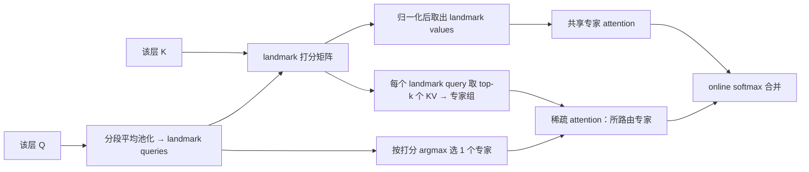

# MiTA Attention

MiTA（Mixture of Top-$k$ Activations）是一种把「全局概括」与「局部精选」放进同一次 softmax 注意力的线性复杂度机制。它在不新增路由网络参数的前提下，先用极少数探针向量把整段键值浓缩为一个常开的共享专家，再让每个探针各自挑出最相关的少数原始键值组成局部专家；计算时每个 query 只需读取这份全局摘要与最匹配的一个局部专家，从而以常数级键值预算兼顾全局上下文与局部细节[^src-2602-01219-mita]。

## 问题定位

从 [[fast-weight-mlp-view-of-attention|fast-weight 视角]]看，标准 full attention 等价于一个宽度随序列长度线性膨胀的两层网络，因此序列变长后计算量呈二次方增长。现有线性化方案分裂为两条路线，各有结构性缺口：单纯走**压缩**（如 [[agent-attention|Agent Attention]]、Linformer、线性注意力）把全部键值压入固定槽位，代价是丢失对原始精细键值的直接访问；单纯走**稀疏路由**（如 [[moba-attention|MoBA]]、[[deepseek-sparse-attention|DSA]]）只读取少量被选中的原始键值，却缺乏对未选中区域的全局概括[^src-2602-01219-mita]。

论文提出在同一次注意力归一化中同时保留这两条支路，用压缩支路提供全局视野、用路由支路恢复对关键原始 token 的精确访问[^src-2602-01219-mita]。

## 机制拆解

剥离论文术语，MiTA 的前向计算完全由标准算子拼装而成：**分段平均池化（`AdaptiveAvgPool`）生成探针 + 一次探针打分三处复用 + 变长 FlashAttention 稀疏计算 + online softmax 合并**。它直接替换 Transformer 块内的 self-attention，沿用原层投影矩阵，不额外引入路由参数，也不使用 MoE 负载均衡辅助损失[^src-2602-01219-mita]。

核心巧思在于**一次打分、三处复用**：用池化出的 $m$ 个 landmark query 对全部 key 只算一次相似度矩阵，这份打分同时承担三项职责——逐列取 Top-$k$ 挑出各 [[deformable-fast-weight-experts|形变专家]] 的原始键值、经 softmax 加权汇总出共享专家的全局摘要 value，以及复用同一组探针为每个 query 分配局部专家[^src-2602-01219-mita]。

## 数据流与维度

> **维度符号**：$N$ 序列长度（token 数）；$d$ 单头通道维；$m$ landmark query 数（默认 $25$）；$k$ 每个形变专家选中的 KV 数（默认 $25$）；$s$ 每 query 路由的专家数（默认 $1$）；$n_i$ 归入专家 $i$ 的 query 数，满足 $\sum_i n_i = N$。形状记作 $[\text{行}, \text{列}]$，与论文单头记号一致；多头在 batch 维展开为本页推断[^src-2602-01219-mita][INFERENCE]。

### Stage 1 · 造 landmark query

$$\begin{aligned}
\tilde{Q} &= \operatorname{AdaptiveAvgPool}(Q,\ \text{output\_size}=m) && \text{// } [d, N] \xrightarrow{\text{沿 } N \text{ 维均分 } m \text{ 段取均值}} [d, m]\ \text{——} N \text{ 个 query 压成 } m \text{ 个探测向量}
\end{aligned}$$

### Stage 2 · 一次打分，造出两组 KV 视图

$$\begin{aligned}
S^{kv} &= K^{\top}\tilde{Q}/\sqrt{d} && \text{// } [N, \bcancel{d}]\times[\bcancel{d}, m]\to[N, m]\ \text{——消去 } d\text{，每列是一个 landmark 对全部 } N \text{ 个 key 的打分}\\
\mathcal{I}_i &= \operatorname{Top}_k\!\left(K^{\top}\tilde{q}_i\right) && \text{// } [N, m] \xrightarrow{\text{沿 } N \text{ 维逐列 Top-}k} [k, m]\ \text{——每组 } k \text{ 个 key 下标（取值 } 1..N\text{）}\\
K^{\mathrm{expt}}, V^{\mathrm{expt}} &= K[:,\mathcal{I}^{kv}],\ V[:,\mathcal{I}^{kv}] && \text{// } [d, N] \xrightarrow{\text{按 } \mathcal{I}^{kv}\in[mk] \text{ 索引列}} [d, mk]\ \text{——专家 } i \text{ 占槽位 } [ik,(i+1)k)
\end{aligned}$$

同一个 key 可以进入多个专家，因此全部专家覆盖的去重键值上限为 $\min(mk, N)$[^src-2602-01219-mita]。

### Stage 3 · 两条支路并行

- **支路 A：共享专家（常开，宽 $m$）**。读取全量 $V$ 与 Stage 2 打分 $S^{kv}$，输出全局摘要注意力。

$$\begin{aligned}
\tilde{V} &= V\operatorname{softmax}\!\left(S^{kv}\right) && \text{// } [d, \bcancel{N}]\times[N, m] \xrightarrow{\text{softmax 沿 } N} [d, m]\ \text{——全部 value 加权成 } m \text{ 个摘要}\\
A^{\mathrm{share}} &= \operatorname{softmax}\!\left(\tilde{Q}^{\top}Q/\sqrt{d}\right) && \text{// } [m, \bcancel{d}]\times[\bcancel{d}, N]\to[m, N] \xrightarrow{\text{softmax 沿 } m} [m, N]\\
O^{\mathrm{share}} &= \tilde{V}A^{\mathrm{share}} && \text{// } [d, \bcancel{m}]\times[\bcancel{m}, N]\to[d, N]\ \text{——每 query 只对 } m \text{ 对摘要 KV}
\end{aligned}$$

- **支路 B：形变专家（稀疏，宽 $k$）**。记 $Q^{(i)}\in[d, n_i]$ 为归入专家 $i$ 的 query 列，$K^{(i)}, V^{(i)}\in[d,k]$ 为其对应的 Top-$k$ 原始 KV。

$$\begin{aligned}
R &= \tilde{Q}^{\top}Q && \text{// } [m, \bcancel{d}]\times[\bcancel{d}, N]\to[m, N]\ \text{——与 } S^{kv} \text{ 同型，只把 } K \text{ 换成 } Q\\
e_1 &= \operatorname{ArgMax}_{m} R && \text{// } [m, N] \xrightarrow{\text{沿 } m \text{ 维 ArgMax}} [N]\ \text{——每 query 选 1 个专家编号}\\
\mathcal{I}^{\mathrm{expt}} &= \operatorname{ArgSort}(e_1) && \text{// } [N] \xrightarrow{\text{按编号排序}} [N]\ \text{——只重排 query 列序，不改数值}\\
A^{(i)} &= \operatorname{softmax}\!\left(K^{(i)\top}Q^{(i)}/\sqrt{d}\right) && \text{// } [k, \bcancel{d}]\times[\bcancel{d}, n_i]\to[k, n_i] \xrightarrow{\text{softmax 沿 } k} [k, n_i]\\
O^{(i)} &= V^{(i)}A^{(i)} && \text{// } [d, \bcancel{k}]\times[\bcancel{k}, n_i]\to[d, n_i]\ \text{——只算路由到专家 } i \text{ 的 } n_i \text{ 个 query}
\end{aligned}$$

实现时无需逐专家循环：将 $Q$ 按专家编号重排后，配合累计长度偏移量调用一次变长 FlashAttention 即可并行算出全部专家输出[^src-2602-01219-mita]。

### Stage 4 · 汇合为一次 softmax

$$\begin{aligned}
K^{\star} &= [\,\tilde{Q},\,K^{(e_1)}\,] && \text{// } [d, m]\oplus[d, k]\to[d, m+k]\quad(s>1:\ [d, m+ks])\\
V^{\star} &= [\,\tilde{V},\,V^{(e_1)}\,] && \text{// } [d, m]\oplus[d, k]\to[d, m+k]\\
\Lambda &= K^{\star\top}Q/\sqrt{d} && \text{// } [m{+}k, \bcancel{d}]\times[\bcancel{d}, N]\to[m{+}k, N]\ \text{——前 } m \text{ 行即 } R/\sqrt{d}\\
O &= V^{\star}\operatorname{softmax}(\Lambda) && \text{// } [d, \bcancel{m{+}k}]\times[\bcancel{m{+}k}, N]\to[d, N]\ \text{——全局与局部在同一分母下竞争}
\end{aligned}$$

两条支路不是各自归一化后再加权，而是借 online softmax 的 log-sum-exp 统计量精确等价于拼接后的单次 softmax。因此每个 query 看到的键值宽度固定为 $m+ks$（默认 $50$ 对），核心注意力复杂度为 $\mathcal{O}(N(m+ks))$；但前期的 $\mathcal{O}(Nm)$ 探针打分与非连续 `gather` 随机访存会成为长序列下的实际带宽瓶颈，论文未给出自定义 kernel 优化[^src-2602-01219-mita]。

## 与既有工作的关系

MiTA 在高效注意力谱系中与两个近邻构成明确的结构关系：

- **数学同构与算子 $\Delta$（vs [[agent-attention|Agent Attention]]）**：MiTA 的共享专家支路在数学上与 Agent Attention 的「agent aggregation + agent broadcast」两段式完全同构——两者都先对 $Q$ 池化出探针向量，再据此聚合 $V$ 并向 $Q$ 广播。MiTA 的核心增量改动（$\Delta$）在于复用同一份探针打分，额外构造 $m$ 组按内容选出的 Top-$k$ 原始 KV 形变专家，将单一全局摘要扩展为 $N$-to-$m$ 稀疏路由[^src-2312-08874-agent-attention][^src-2602-01219-mita]。
- **同槽位互斥对照（vs [[native-sparse-attention|NSA]]）**：两者都在同一注意力层结合「压缩」与「稀疏选块」，核心分歧在于多支路合并方式与验证域，且目前没有同台实验[^src-2502-11089-nsa][^src-2602-01219-mita]。

| 设计轴 | MiTA | [[native-sparse-attention|NSA]] |
|---|---|---|
| 支路合并方式 | 拼接后单次 softmax（全局与局部同分母竞争） | 压缩、选块、滑窗三支路各自 softmax + sigmoid 门控求和 |
| 稀疏单元 | 内容驱动的 Top-$k$ 非连续 token（形变专家） | 位置连续的固定大小 token 块（块选择） |
| 路由打分来源 | landmark query 的打分矩阵 $S^{kv}$ 三处复用 | 压缩支路注意力分数直接驱动 Top-$n$ 选块 |
| 实证验证域 | 视觉分类、语义分割、LRA | 27B 语言模型预训练与长上下文推理 |

## 证据

论文在 ImageNet-1K/21K 分类、ADE20K 语义分割、Long Range Arena（LRA）及合成超长序列吞吐上报告了实证结果（均采用作者报告口径）[^src-2602-01219-mita]：

1. **定位与主结论**：MiTA 的实际效果是**以线性复杂度逼近 full attention，而非在短序列精度上超越它**。在 ImageNet 分类中，每 query 仅计算 $50$ 对 KV 的 MiTA 略低于原版 ViT（21K 微调低 $0.3\sim 1.6$ 个点），但跨规模稳定领先纯压缩基线 Agent-ViT 与 Linear-ViT；在更长序列的 ADE20K 分割（$N=1024$）与 LRA（$1\text{K}\sim 4\text{K}$）上与 full attention 总体持平，并在超长合成序列（至 $2^{20}$）上展现显著吞吐优势。
2. **真实涨点归因**：在同骨干对照下，相较纯压缩路线 Agent-ViT 的稳定增益来自「全局摘要 + 原始 KV 稀疏专家」的互补结构；但 ImageNet 从头训练中的高分版本同时依赖 depth-wise convolution，且作者报告推理期增大 $(m,k)$ 比减小更稳健，checkpoint 迁回 full attention 时掉点较小。
3. **证据缺口与负结果**：第一，实验仅对比压缩系基线（Agent-ViT、Linear-ViT），**完全缺席 MoBA、NSA、DSA 等同生态位稀疏路由基线**；第二，全文缺少核心超参 $(m,k,s)$ 配比与双支路各自贡献的消融实验；第三，LRA 中的文本与检索子任务仍落后于 full attention，视觉以外场景的泛化尚未建立。

## 相关页面

- [[source-2602-01219-mita]] — 源摘要
- [[fast-weight-mlp-view-of-attention]] — 理论视角基础
- [[fast-weight-scaling-taxonomy]] — 五维缩放分类与 MiTA 所在格
- [[deformable-fast-weight-experts]] — 内容驱动的形变专家概念
- [[agent-attention]] — 共享专家支路的同构前作
- [[native-sparse-attention]] — 同槽位多支路合并方式对照
- [[moba-attention]] — 位置块路由的同槽位对照
- [[cbsa]] · [[representative-token-extraction]] — 压缩支路的同族机制
- [[mixture-of-experts]] — MoE 思想向注意力层的迁移

[^src-2602-01219-mita]: [[source-2602-01219-mita]]
[^src-2502-11089-nsa]: [[source-2502-11089-nsa]]
[^src-2312-08874-agent-attention]: [[source-2312-08874-agent-attention]]
