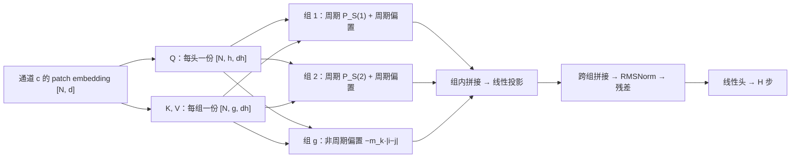

# PENGUIN

PENGUIN（Periodic-Nested Group Attention）是 Sun、Chen、Sun（复旦大学 / 小红书，AISTATS 2026）提出的长时序预测模型：以 [[patchtst|PatchTST]] 式的通道独立 patch embedding 为骨干，把**周期长度写成注意力分数上的加性相对偏置**，并用**分组多查询注意力**让每组绑定一个周期[^src-penguin]。源摘要见 [[source-penguin]]，偏置本身的可迁移做法单列为 [[periodic-nested-attention-bias]]。

## 问题定位

论文把 LTSF 的争议拆成两个观察（§2.1）[^src-penguin]：

1. 相对注意力偏置（RAB）在 NLP 与 LLM 中已被验证（T5 bias、[[alibi|ALiBi]]、Sturua et al.），但在时序预测中"remains under-exploited"；
2. 已有的多周期处理要么是频域分解（Autoformer、FEDformer，论文批评其跨窗谱不一致），要么是按周期把序列展开成多条（[[timesnet|TimesNet]]，论文称其 computational inefficient）。

一句可迁移的结论（本页组织口径，非论文表述）：**周期结构可以作为距离惩罚的折叠方式进入注意力，而不必作为数据变换进入输入端**。

## 机制

### 周期化偏置：模 + 三角折叠

对 query 位置 $i$ 与 key 位置 $j$，先取模得到相位差，再折到半周期内（式 6）[^src-penguin]：

$$u_{ij}=|i-j| \bmod P_S^{(r)},\qquad \hat B_{ij}=\min\!\left(u_{ij},\;P_S^{(r)}-u_{ij}\right),\qquad B_{ij}^{(k)}=-m_k\,\hat B_{ij}$$

其中 $m_k=2^{-k/8}$（$k$ 为组内头序号），斜率固定不训练、且在各组之间共享。折叠后的偏置在半周期处最大（惩罚最重）、同相位处为 0，于是"同相位对齐"在 softmax 里获得相对优势。跨周期的 lag 得到相同偏置，这是它与 [[linear-attention-bias|线性偏置]] 的唯一差别。

无周期数据集走另一条路：$B_{ij}^{(k)}=-m_k|i-j|$（式 5），即 ALiBi 原式；论文另留一个非周期组与周期组并存（footnote 3、Table 3 的 Both 设置）[^src-penguin]。

**patch 之后周期要重算**：$P_S^{(r)}=P_r/S$（要求 $S$ 整除每个 $P_r$）。Fig. 2 的例子是原始周期 12、patch 长 8、步长 4，得 $P_S=3$[^src-penguin]。

### 分组多查询注意力

$h$ 个头分 $g$ 组（要求 $g\mid h$），组内 $n=h/g$ 个头各自保留 query，但**共享该组的 $K,V$**；每组绑定一个周期长度，组内每个头各有一份按自身斜率缩放的偏置（式 4）[^src-penguin]。输出按组内拼接、再跨组拼接。

设组数为 $g$ 后，$K,V$ 的参数量与显存是 $g/h$ 个头的量级，这是论文处理多周期时相对 TimesNet 的省法；代价是组内 $n$ 个头被迫共享同一组 KV。

### 训练配置

RevIN 逐通道归一化 + 固定正弦位置编码 + RMSNorm（归一化作用在子层输出上）+ MSE 损失（式 1–3、7、8）[^src-penguin]。$L=336$、$H\in\{96,192,336,720\}$ 为主设置；Table 8 给出逐数据集 batch、$d$、$P$、$S$（例如 Traffic $d=512,P=16,S=8$，ETTh1 $d=16,P=1,S=1$）[^src-penguin]。编码器层数 $E$、$d_{ff}$、优化器与学习率论文未给[^src-penguin]。

## 数据流与维度

**维度符号**：$C$ 通道数；$L$ 回看长度（主实验 336）；$H$ 预测步数；$P$ patch 长度；$S$ patch 步长；$N$ patch 数；$d$ 隐藏维；$h$ 头数（消融固定 12）；$g$ 组数；$n=h/g$ 组内头数；$d_h=d/h$ 单头通道维；$\mathcal{P}=\{P_1,\dots,P_p\}$ 周期集合（先验给定）；$P_S^{(r)}=P_r/S$ 为第 $r$ 组 patch 后的周期。形状记 $[\text{行},\text{列}]$，按单通道书写，$C$ 维在 batch 维展开。

### Stage 1 · 归一化、切窗与嵌入

$$\begin{aligned}
\tilde x^{(c)} &= \frac{x^{(c)}-\mu^{(c)}}{\sqrt{\sigma^{(c)}+\epsilon}} && \text{// } [L]\to[L]\ \text{——RevIN 用本条样本的逐通道统计量缩放，预测后反归一化}\\
X_p^{(c)} &= \operatorname{Unfold}\!\left(\tilde x^{(c)};P,S\right) && \text{// } [L]\xrightarrow{\text{窗长 } P \text{、步长 } S}[N, P]\ \text{——原文写 } N=\lfloor (L-P)/S\rfloor+2\\
\tilde X^{(c)} &= X_p^{(c)}W_p+b_p+PE && \text{// } [N,\bcancel{P}]\times[\bcancel{P},d]\to[N,d]\ \text{——每个 patch 投成一行 token，加固定正弦位置编码}
\end{aligned}$$

### Stage 2 · 一次投影分出 per-head Q 与 per-group K/V

$$\begin{aligned}
Q &= \tilde X W_Q && \text{// } [N,\bcancel{d}]\times[\bcancel{d},hd_h]\to[N,h,d_h]\ \text{——每个头独立的 query}\\
K &= \tilde X W_K && \text{// } [N,\bcancel{d}]\times[\bcancel{d},gd_h]\to[N,g,d_h]\ \text{——每组只有一份 key，$n$ 个头共用}\\
V &= \tilde X W_V && \text{// } [N,\bcancel{d}]\times[\bcancel{d},gd_h]\to[N,g,d_h]\ \text{——同形状，与 }K\text{ 成对}
\end{aligned}$$

$K,V$ 的宽度是 $g d_h$ 而非 $h d_h$：组数越少，key/value 侧越窄。

### Stage 3 · 三条支路各自造偏置

**支路 A：周期组 $r$（绑定 $P_S^{(r)}$）**

$$\begin{aligned}
u_{ij} &= |i-j| \bmod P_S^{(r)} && \text{// } [N,N]\xrightarrow{\text{逐元素取模}}[N,N]\ \text{——跨周期的 lag 折回同一相位}\\
\hat B_{ij} &= \min\!\left(u_{ij},\,P_S^{(r)}-u_{ij}\right) && \text{// } [N,N]\to[N,N]\ \text{——三角折叠，同相位 0、半周期处最大}\\
B^{(k)}_{ij} &= -m_k\,\hat B_{ij} && \text{// } [N,N]\to[N,N]\ \text{——斜率 }m_k=2^{-k/8}\text{ 固定且跨组共享}
\end{aligned}$$

**支路 B：非周期组（EXCHANGE 这类 $\mathcal{P}=\varnothing$ 的数据靠它）**

$$\begin{aligned}
B^{(k)}_{ij} &= -m_k\,|i-j| && \text{// } [N,N]\ \text{——ALiBi 原式，只惩罚距离}
\end{aligned}$$

**支路 C：不加偏置的组**（Table 3 的 No Bias 情形，作为消融基线存在）。三支路的偏置形状都是 $[n,N,N]$：组内每个头一张 $N\times N$ 表，差别只在 $P_S^{(r)}$ 与斜率。

### Stage 4 · 组内打分、归一化、组投影

$$\begin{aligned}
\Lambda^{(r)}_{\ell} &= Q_\ell K_r^{\top}/\sqrt{d_h}+B^{(k)} && \text{// } [N,\bcancel{d_h}]\times[\bcancel{d_h},N]\to[N,N]\ \text{——偏置与打分逐元素相加后才 softmax}\\
H^{(r)}_{\ell} &= \operatorname{softmax}\!\left(\Lambda^{(r)}_{\ell}\right)V_r && \text{// } [N,\bcancel{N}]\times[\bcancel{N},d_h]\to[N,d_h]\ \text{——softmax 沿 key 维，组内共享同一份 }V_r\\
O_r &= \operatorname{Output}_r\!\left(H^{(r)}_{\tau+1}\|\cdots\|H^{(r)}_{\tau+n}\right) && \text{// } [N,nd_h]\to[N,\cdot]\ \text{——组内拼接后线性投影；原文未给投影输出宽度}
\end{aligned}$$

$\tau=(r-1)n$ 是第 $r$ 组的头偏移。原文写 $k=\ell \bmod n+1$，与「组 $r$ 占 $\ell\in[\tau+1,\tau+n]$」组合后整体错位一位，按原文照录[^src-penguin]。

### Stage 5 · 跨组拼接与预测

$$\begin{aligned}
\operatorname{PENGUIN}(X) &= O_1\|\cdots\|O_g && \text{// } g\text{ 段拼接}\\
\tilde X^{(l,1)} &= \tilde X^{(l-1)}+\operatorname{RMSNorm}\!\left(\operatorname{PENGUIN}(\tilde X^{(l-1)})\right) && \text{// } [N,d]\to[N,d]\ \text{——式 1 的写法是「残差 + 归一化子层输出」}\\
\tilde X^{(l)} &= \tilde X^{(l,1)}+\operatorname{RMSNorm}\!\left(\operatorname{FFN}(\tilde X^{(l,1)})\right) && \text{// } [N,d]\to[N,d]\\
\hat X^{(c)} &= \tilde X^{(c,E)}W_o && \text{// } [N,\bcancel{d}]\times[\bcancel{d},H]\to[N,H]\ \text{——线性映射到 }H\text{ 步}
\end{aligned}$$

两点原文未交代处，按推断标注：各组投影后的宽度必须使拼接结果回到 $d$ 才能与残差相加，而论文只写"拼接"（[INFERENCE]）；末层如何从 $[N,d]$ 得到 $[H,C]$ 也未说明，decoder 变体（App. B）则明确用 $M=H/S$ 个可学习 query[^src-penguin]。

### 结构要点

- **周期只改偏置，不改数据布局**：与 TimesNet 的 2D 重排、Autoformer 的分解不同，输入仍是 $[N,P]$ 的 patch 序列；多周期只体现在"每组建一张 $N\times N$ 偏置表"。
- **偏置是常量表**：$m_k$ 与 $P_S^{(r)}$ 都不训练，单层注意力新增的可训练参数只有 $W_Q,W_K,W_V$ 与组投影。
- **因果掩码只在实验里出现**：式 4 未写 mask，$\S5.6$ 靠 Figure 4 的热图论证去掉掩码后 ETTh1/ETTh2 掉 3.5%/4.8%，无表格数值[^src-penguin]。

## 结果

$L=336$、四个 horizon 平均（Table 2 / Table 10）[^src-penguin]：

| 数据集 | PENGUIN | 数值最低的基线 |
|---|---|---|
| ETT（四子集均值） | 0.344 / 0.379 | CycleNet 0.351 / 0.384 |
| Electricity | 0.165 / 0.261 | CycleNet 0.160 / 0.253 |
| Exchange | 0.340 / 0.403 | MTLinear 0.285 / 0.380 |
| Weather | 0.228 / 0.267 | CATS 0.227 / 0.266 |
| Solar | 0.200 / 0.253 | MSE 由 PENGUIN 最低；MAE 由 CATS 0.248 最低 |
| Traffic | 0.388 / 0.262 | PENGUIN |
| 9 数据集均值 | 0.300 / 0.330 | CycleNet 0.317、CATS 0.319 |

**逐项消融（Table 3，Traffic / Electricity，avg MSE）**[^src-penguin]：

| 设置 | Traffic | Electricity |
|---|---|---|
| No Bias（单组 MQA） | 0.407 | 0.171 |
| 非周期偏置（式 5） | 0.396 | 0.169 |
| 周期组 $\{24\}$ / $\{168\}$ / $\{24,168\}$ | 0.392 / 0.392 / 0.390 | 0.166 / 0.166 / 0.165 |
| 非周期组 + 周期组 $\{24\}$ / $\{168\}$ / $\{24,168\}$ | 0.388 / 0.389 / 0.387 | 0.167 / 0.169 / 0.166 |

拆解读法：偏置本身贡献最大（0.407→0.396），换成周期偏置再降一档（→0.390），多周期与"加一个非周期组"各自只有约 0.5% 量级。MHA→GQA（Table 4）在 Traffic 上每迭代 0.166→0.145 s、MSE 0.389→0.387；Electricity 0.239→0.224 s、0.167→0.165[^src-penguin]。

插件性（Table 6）：把 PENGUIN 的偏置装到 CATS 式 cross-attention 的 decoder 上，ETTm1 的 avg MSE 0.448→0.361（decoder）与 0.520→0.354（encoder-decoder），ETTh1 为 0.478→0.430 与 0.495→0.419，Weather 仅 0.228→0.226 与 0.236→0.231[^src-penguin]。该实验的基线架构论文未明确指出。

周期鲁棒性（Table 7）：ETTm1 用正确 $\{96\}$ 得 0.343，错给 $\{72\}$/$\{144\}$ 得 0.349，完全不给周期得 0.349；Traffic 不给周期 0.396，仍低于 CATS 0.411[^src-penguin]。

## 边界

- **周期必须预先给定**：$P_r$ 是超参，ACF 只是被引用的离线取法，论文没有检测实验；作者自述不适用于周期随时间变化的信号（ECG），后续计划补 flash / linear attention（$\S$F）[^src-penguin]。
- **组与周期的对应规则未定义**：$p>1$ 时哪个周期进哪一组、$g$ 取多少，论文只给"一组一周期、留一组非周期"的定性描述，没有扫 $g$ 的消融[^src-penguin]。
- **精度优势是均值和个别数据集**：6 个数据集分组里 PENGUIN 的 MSE 只在 ETT、Solar、Traffic 上最低（Solar 的 MAE 仍输 CATS），Electricity 为第三、Weather/Exchange 为第二；主表单种子，无显著性检验，因此更适合当作"偏置有效"的证据而不是稳健的 SOTA 结论[^src-penguin]。
- **效率证据弱**：Figure 3 只有对数坐标散点，无参数量、MACs、显存绝对值；论文正文的"最低计算成本"没有数值支撑[^src-penguin]。
- **与 [[periodicity-modeling-in-time-series|周期建模路线图]] 中其他路线的关系**：周期在 attention 内（本页）、周期在输入端重排（[[witran|WITRAN]] / TimesNet）、周期在残差里（[[cyclenet|CycleNet]] 的 RCF）——Table 5 显示把 RCF 加到 PENGUIN 上在 Traffic 反而变差（0.388→0.401），Solar/Electricity 只有 1% 量级波动[^src-penguin]。

## 引用

[^src-penguin]: [[source-penguin]]
