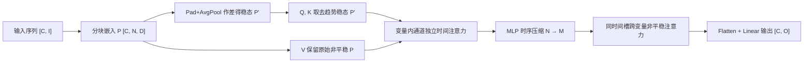

# TimeBridge

TimeBridge 是清华大学深圳国际研究生院与深圳大学团队提出的多变量长时预测模型（ICML 2025），核心解决传统方法对待非平稳性时「全盘抹平」或「全盘保留」的两难困境。作者认为非平稳趋势在单变量短程时间片内容易诱发伪相关，而在跨变量之间却恰恰是长期协整关系的载体；因此模型将非平稳性按作用域分层拆解，先在各变量内部基于去趋势后的稳态分量计算时间注意力、在值向量中保留原始信号以省去反归一化，再把时间维度压缩后于保留非平稳性的前提下执行跨变量注意力[^src-timebridge]。

## 问题定位

现实多变量时间序列普遍存在均值或趋势漂移等非平稳现象。既有深度预测模型处理这一特性时往往走入两个极端：一类在序列入口处用 [[instance-normalization|RevIN]] 等可逆实例归一化剥离全局统计量以改善泛化，代价是同时抹平了跨变量之间共享的长期变化趋势；另一类则全量保留非平稳信号以捕捉趋势，却在单变量局部时间窗口内因共同漂移而学出虚假的短程时间相关[^src-timebridge]。

论文由此提出按作用域正交解耦非平稳性的双重角色：变量内的短程时间依赖需要稳态特征来抑制伪相关，而跨变量之间的长期协同依赖则需要保留非平稳趋势来承载协整关系[^src-timebridge]。

## 机制拆解

剥离论文术语，TimeBridge 的核心架构由标准算子按「变量内去趋势稳态时间注意力 → 时序下采样 → 跨变量非平稳注意力」两阶段串行构成，并配合频时联合 MAE 损失训练[^src-timebridge]：

- **非对称稳态时间注意力（论文称 Integrated Attention）**：先将每条变量序列切分为时序 patch，再以填充后的平均池化作平滑差（$P' = P - \operatorname{AvgPool}(\operatorname{Pad}(P))$）抽取 patch 级局部趋势残差。计算通道独立时间自注意力时，仅将去趋势后的稳态分量 $P'$ 送入查询与键（$Q, K$），而值（$V$）直接保留未去趋势的原始 patch 表示 $P$。这一非对称分工既避免趋势诱发伪注意力权重，又使输出天然保持原始趋势尺度，无需额外反归一化[^src-timebridge]。
- **时序压缩与跨变量非平稳注意力（论文称 Cointegrated Attention）**：用沿时间块轴的 MLP 将每个变量的 patch 数从 $N$ 压缩至 $M$，再在每个压缩时间槽对应的跨变量切片上**不做去趋势**直接计算跨变量自注意力，捕捉共享非平稳趋势下的长期协整，最后展平并线性映射至预测长度[^src-timebridge]。

## 数据流与维度

> **维度符号**：$C$ 变量（通道）数；$I$ 输入回看长度；$S$ 分块步长（块数 $N=I/S$）；$D$ patch 隐特征维；$M$ 压缩后的时间槽数（$M<N$）；$O$ 预测长度。多头拆分及线性投影矩阵维度为按单头等价展开的缺省推断 `[INFERENCE]`[^src-timebridge]。

### Stage 1 · 序列分块与 patch 级去趋势

$$\begin{aligned}
P &= \operatorname{PatchEmbed}(X) && \text{// } [C, I] \xrightarrow{\text{按步长 } S \text{ 切分并嵌入}} [C, N, D]\ \text{——构造 } N=I/S \text{ 个通道独立时序块 [INFERENCE]}\\
P' &= P - \operatorname{AvgPool}(\operatorname{Pad}(P)) && \text{// } [C, N, D] \xrightarrow{\text{沿 } N \text{ 维平滑作差}} [C, N, D]\ \text{——剥离局部非平稳趋势，仅作稳态 } Q,K \text{ 输入}
\end{aligned}$$

### Stage 2 · 变量内稳态时间注意力（Integrated Attention）

沿变量维 $C$ 并行执行通道独立时间自注意力，查询与键读取去趋势稳态分量 $P'$，值向量读取未去趋势原始块 $P$[^src-timebridge]：

$$\begin{aligned}
Q,\ K,\ V &= P' W^Q,\ P' W^K,\ P W^V && \text{// } [C, N, \bcancel{D}]\times[\bcancel{D}, D]\to[C, N, D]\ \text{——} Q,K \text{ 去趋势稳态，} V \text{ 保留非平稳趋势 [INFERENCE]}\\
S_{\text{time}} &= Q K^{\top} / \sqrt{D} && \text{// } [C, N, \bcancel{D}]\times[C, \bcancel{D}, N]\to[C, N, N]\ \text{——消去 } D\text{，得到单变量内部时间块打分 [INFERENCE]}\\
H_{\text{int}} &= \operatorname{softmax}(S_{\text{time}}) V && \text{// } [C, N, \bcancel{N}]\times[C, \bcancel{N}, D]\to[C, N, D]\ \text{——消去键侧 } N\text{，沿时间维聚合未去趋势表征 [INFERENCE]}
\end{aligned}$$

### Stage 3 · 时序压缩与跨变量非平稳注意力（Cointegrated Attention）

先沿时间块轴用 MLP 压缩长程冗余，再对每个压缩槽位 $n\in\{1,\dots,M\}$ 的跨变量切片直接执行保留非平稳性的变量间自注意力[^src-timebridge]：

$$\begin{aligned}
H_{\text{down}} &= \operatorname{MLP}_N(H_{\text{int}}) && \text{// } [C, N, D] \xrightarrow{\text{沿 } N \text{ 维压缩至 } M} [C, M, D]\ \text{——浓缩变量内稳态提取结果}\\
Z_n &= H_{\text{down}}[:, n, :] && \text{// } [C, M, D] \xrightarrow{\text{按时间槽 } n=1..M \text{ 切片}} [C, D]\ \text{——同时间槽跨变量非平稳切片}\\
\tilde{Q}_n,\ \tilde{K}_n,\ \tilde{V}_n &= Z_n\tilde{W}^Q,\ Z_n\tilde{W}^K,\ Z_n\tilde{W}^V && \text{// } [C, \bcancel{D}]\times[\bcancel{D}, D]\to[C, D]\ \text{——保留非平稳性以捕获长期协整 [INFERENCE]}\\
H_{\text{coint},n} &= \operatorname{softmax}\!\left(\tilde{Q}_n \tilde{K}_n^{\top}/\sqrt{D}\right)\tilde{V}_n && \text{// } [C, \bcancel{C}]\times[\bcancel{C}, D]\to[C, D]\ \text{——消去键侧 } C\text{，槽内跨变量交互复杂度 } \mathcal{O}(C^2 M)\ \text{[INFERENCE]}
\end{aligned}$$

### Stage 4 · 展平与预测输出

$$\begin{aligned}
H_{\text{out}} &= \operatorname{Flatten}(H_{\text{coint}}) && \text{// } [C, M, D] \xrightarrow{\text{沿 } M,D \text{ 展平}} [C, MD]\ \text{——汇合全部压缩槽位表示 [INFERENCE]}\\
\hat{Y} &= \operatorname{Linear}(H_{\text{out}}) && \text{// } [C, \bcancel{MD}]\times[\bcancel{MD}, O]\to[C, O]\ \text{——映射至各变量未来 } O \text{ 步预测}
\end{aligned}$$

代价在于超参 $N, M$ 需按数据集单独调优，且跨变量注意力 $\mathcal{O}(C^2 M)$ 在 $862$ 维 Traffic 等高维场景下计算量显著上升[^src-timebridge][^src-renf]。

## 与既有工作的关系

| 模型 | 非平稳性处理策略 | 变量内时序建模 | 跨变量交互粒度 | 核心取舍 |
|---|---|---|---|---|
| [[patchtst\|PatchTST]] | 序列级 RevIN 全量去平稳 | 通道独立 patch 注意力[^src-patchtst] | 无（纯通道独立） | 抑制伪相关但放弃跨变量协整 |
| [[itransformer\|iTransformer]] | Variate token 级 LayerNorm | FFN 隐式映射整序列[^src-itransformer] | 单一全局 variate token | 交互干净但损失局部时间分辨率 |
| **TimeBridge** | 作用域正交（$Q,K$ 去趋势，$V$ 与跨变量留平稳） | 非对称稳态时间注意力[^src-timebridge] | $M$ 个压缩时间槽逐槽交互 | 兼顾短程稳态与长期协整，代价为 $\mathcal{O}(C^2 M)$ |
| [[source-pesd-tsf\|PESD-TSF]] | 延续 $Q,K$ 去趋势 + $V$ 留原始趋势 | 日历门控 + 稳态时间注意力[^src-pesd-tsf] | 下采样后时间 GAP 单向量 | 压低高维显存但抹平时间槽分辨率 |

- **瓶颈接力 $\Delta$（[[patchtst|PatchTST]] → TimeBridge）**：TimeBridge 沿用 PatchTST 的分块与通道独立时间注意力骨架，将同质 $Q/K/V$ 改为「$Q,K$ 去趋势稳态、$V$ 留非平稳」非对称设计，并在时间压缩后补入跨变量协作[^src-timebridge][^src-patchtst]。
- **同槽位互斥（vs [[itransformer|iTransformer]]）**：iTransformer 将整条变量序列压成单个 token 交互；TimeBridge 先经变量内稳态注意力和 MLP 压缩保留 $M$ 个时间槽，在更高局部时间分辨率上做跨变量非平稳注意力[^src-timebridge][^src-itransformer]。
- **同槽位互斥与复现口径对照（vs [[timemixer|TimeMixer]]）**：TimeMixer 以纯 MLP 多尺度季节/趋势混合处理非平稳性；在 TimeBridge 的标准长时基准下，TimeBridge 较 TimeMixer 平均降低 MSE $13.66\%$，但在 PeMS04 MAE 上略逊于 TimeMixer[^src-timebridge][^src-timemixer]。
- **跨槽位正交（vs [[channel-independence|Channel Independence]]）**：仅在变量内阶段保留通道独立以避免短程伪相关，压缩后切换至通道依赖以学习长期协整[^src-timebridge]。
- **特例演进（vs [[instance-normalization|RevIN]] 与 Non-stationary Transformers）**：将序列入口整窗去平稳改为 patch 级平滑作差且仅限变量内 $Q,K$，省去末端反归一化；相对 Non-stationary Transformers 的统计量调制注意力，改为直接基于 $Q,K,V$ 内容分工[^src-timebridge]。
- **下游瓶颈接力与正交对照（[[source-pesd-tsf|PESD-TSF]]、[[source-renf|ReNF]]）**：PESD-TSF 直接继承其 `IntAttention` 非对称 $Q/K$ 去趋势机制，后端改用双分支下采样与时间 GAP 以扩展至 $5{,}826$ 维[^src-pesd-tsf]；ReNF 在结构上走纯时间 MLP 逐段拼接（BDO）与 EMA 早停，损失侧则整段沿用 TimeBridge 的 $1/n$ 短程加权时频 MAE，且实证对照显示 Traffic 上 TimeBridge MSE 更优（$0.357$ vs $0.365$）、参数更少（$12.4\text{M}$ vs $21.5\text{M}$），但 ReNF 的 FLOPs 约为其 $1/20$（$22.8$ vs $479.2$）[^src-renf]。
- **跨槽位正交（vs [[dataset-stationarity-estimation|Dataset-Level Stationarity Estimation]]）**：后者在检索管线外侧量化序列平稳度以调度超参，TimeBridge 则在模型前向内部按作用域分层处置非平稳信号[^src-timebridge]。

## 证据

论文在长时预测（9 个 LTSF 基准）、短时交通（PeMS）与金融投资组合三类任务上报告了实证结果（均采用作者报告口径）[^src-timebridge]：

1. **定位与主结论**：TimeBridge 在 9 个标准 LTSF 基准中取得 8 项最优（较 TimeMixer 平均降 MSE $13.66\%$、较 ModernTCN 降 $5.56\%$），在 PeMS 交通预测上亦保持领先；但在金融任务上虽然提升了年化收益率（ARR），却伴随更高的收益波动率与最大回撤[^src-timebridge]。
2. **真实涨点归因**：消融实验显示，退化幅度最大的改动是把去平稳与留平稳的作用域放反（变量内留非平稳 + 跨变量去趋势使 Traffic MSE 从 $0.360$ 升至 $0.381$）以及颠倒两阶段先后顺序（先跨变量再变量内压缩使 Traffic MSE 升至 $0.396$）；单独移除去趋势算子仅带来 $0.001\text{–}0.02$ 量级变化，说明核心收益源于「分层作用域正交分工 + 先时间后跨变量顺序」而非单个平滑算子[^src-timebridge]。
3. **证据缺口与负结果**：在 ETTh2 上 TimeBridge 落后于 ModernTCN（$0.341$ vs $0.322$）与 PatchTST，PeMS04 的 MAE 亦略逊于 TimeMixer；协整假说在正文缺乏形式化定理证明（仅附录通过 OLS 残差与 ADF 检验定性佐证）；主实验使用固定回看长度 $L=720$ 对比基线调优后的 $L$ 口径，且全文未设专门的 Limitations 章节[^src-timebridge]。

## 相关页面

- [[source-timebridge]] — 论文源摘要
- [[patchtst]] — 瓶颈接力 $\Delta$（CI patch 骨架改写）
- [[itransformer]] — 同槽位互斥（单 variate token vs $M$ 压缩时间槽）
- [[timemixer]] — 同槽位互斥与复现对照（多尺度 MLP vs 分层非平稳注意力）
- [[channel-independence]] — 跨槽位正交（仅变量内阶段保持 CI）
- [[instance-normalization]] — 特例演进（全局 RevIN → 局部 $Q,K$ 去趋势）
- [[dataset-stationarity-estimation]] — 跨槽位正交（外部平稳性度量 vs 内部作用域分层）
- [[source-pesd-tsf]] — 下游继承（复用 `IntAttention` 非对称去趋势注意力）
- [[source-renf]] — 下游复现与正交对照（沿用时频 MAE 损失与 Traffic 效率对比）

[^src-timebridge]: [[source-timebridge]]
[^src-patchtst]: [[source-patchtst]]
[^src-itransformer]: [[source-itransformer]]
[^src-timemixer]: [[source-timemixer]]
[^src-pesd-tsf]: [[source-pesd-tsf]]
[^src-renf]: [[source-renf]]
