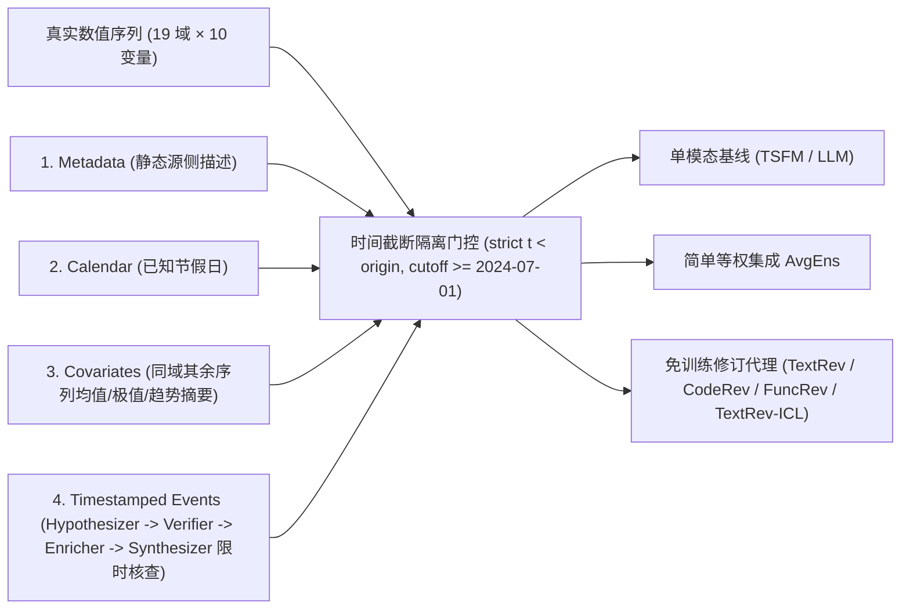

# TimesX

**TimesX** 是一套面向真实世界多模态时间序列预测的无泄露评测基准与上下文构造管线。针对现有合成或缺乏时间隔离的多模态基准会系统性反转模型排序——让大语言模型及其代码修订代理排在专用时序基础模型之上——的问题，TimesX 在真实数值序列上自动采集并核查四类严格早于预测起点的真实时钟上下文，并按被测模型的知识截止时间执行时间隔离，从而还原无预训练泄露条件下的真实预测能力排序[^src-timesx]。

## 问题定位：合成偏差与截断泄露

既有文本增强时序评测存在两类结构性失真，导致模型优劣判断失准[^src-timesx]。其一，以 CiK 为代表的合成基准同时构造数值序列与配套文本且缺乏严格的时间截断隔离，评测排序表现为代码修订代理高于通用大模型，通用大模型又高于专用时序基础模型 `TimesFM`；一旦切换为真实数值与真实外部事件，三者排序随之反转，专用时序基础模型转为领先于通用大模型，而代码修订代理反而拖累预测表现[^src-timesx]。

其二，时间泄露会人为抬高大语言模型的纸面成绩[^src-timesx]。跨越 2024 年 6 月知识截断点前后进行对比评测时，Gemini-2.0-Flash 与 DeepSeek-V3 在无泄露区间上的 MASE 误差恶化约 13% 至 15%，而两类时序基础模型的同期波动不足 2%，证明大语言模型在旧时间段上的领先相当程度上源于预训练语料记忆而非在线时序推理[^src-timesx]。

## 四类上下文管线与时间隔离机制

TimesX 共覆盖 19 个领域、每域 10 个变量，总计 190 条真实单变量序列（包括 12 个周频 Google Trends 领域以及日频大宗商品价格与汇率数据），时间跨度为 2018-01 至 2025-10[^src-timesx]。基准将 2018–2023 年划为训练集、2023–2025 年划为测试集，统一设定回看窗口 $L=96$ 与预测视界 $H=12$，并单列 2024-07-01 起算的无泄露主评测集以隔离主流大模型的预训练知识截断[^src-timesx]。

围绕每条待预测序列，管线自动构造四类严格先于预测起点的上下文信息，并在时间截断门控后送入下游预测或修订模型[^src-timesx]：

1. **元信息（Metadata）**：提供序列所属领域、来源说明与物理口径等静态背景描述[^src-timesx]。
2. **已知日历（Calendar）**：注入预测区间前后已知的节假日与固定日程事件（Holidays）[^src-timesx]。
3. **同域协变量摘要（Covariates）**：将同领域内其余 9 条相关序列的均值、中位数、极值及近期变化趋势压缩为自然语言统计摘要，弥补单变量输入视野的不足[^src-timesx]。
4. **多 Agent 核查时间戳事件（Timestamped Events）**：由检索与核查串联管线（`Hypothesizer → Verifier → Enricher → Synthesizer`）对异常波动周边 $\pm k$ 天窗口执行限时检索与多源交叉核查，剔除事后展望与时间错位文本；在 50 条样本的人工抽检中，事件时间戳精确率达到 94%[^src-timesx]。

在评测框架上，TimesX 同台对比了专用时序基础模型、直接预测的大语言模型、时序基础模型与大模型的等权均值集成 `AvgEns`，以及三类免训练预测后修订代理——直接文本修订 `TextRev`、生成代码修订 `CodeRev` 与函数调用修订 `FuncRev`，并在 `TextRev` 中进一步引入历史修订示例与「保守不改」回退选项构成 `TextRev-ICL`[^src-timesx]。

## 与既有工作的关系

- **瓶颈接力 $\Delta$ 与实证复现对齐（vs [[time-mmd|Time-MMD]]）**：[[time-mmd|Time-MMD]] 开创了 9 域细粒度数值–文本基准并拆分事实与展望段、将截断推至 2024-05；TimesX 进一步扩展至 19 域 190 变量，新增同域协变量摘要与已知节假日两类上下文槽位，并以多 Agent 核查与模型 cutoff 隔离压低泄露风险[^src-time-mmd][^src-timesx]。在完全保持数值序列与提示词不变的前提下，仅将 Time-MMD 文本事件替换为 TimesX 核查事件，几何均值 MASE 即从 0.906 降至 0.840[^src-timesx]。
- **同槽位基准对照（vs [[source-time-imm|Time-IMM]]）**：两者均沿不同方向补齐多模态时序评测缺口——[[source-time-imm|Time-IMM]] 保留异步通道与不规则采样下的独立时间戳日志，TimesX 则聚焦规则日/周频序列的四类真实时钟上下文完整度与 LLM cutoff 防泄露评测[^src-time-imm][^src-timesx]。
- **实证复现对齐（vs [[timesfm|TimesFM]]）**：TimesX 重测指出，[[timesfm|TimesFM]] 在合成基准 CiK 上被系统性低估并排在 LLM 与 `CodeRev` 之后，而在真实数值、真实时钟上下文且无截断泄露的评测中转为稳健领先于 Gemini 与 `CodeRev`[^src-timesx]。
- **跨槽位正交（vs [[in-context-learning|In-Context Learning]]）**：不同于直接用演示对提示基础模型生成预测的视觉或轨迹 ICL，TimesX 中的 `TextRev-ICL` 作用于预测后文本修订槽位，将历史修订案例与「保守不改」选项共同置于上下文中，以抑制免训练修订的方差放大[^src-timesx]。
- **同生态位数据构建对照（vs [[doublecast|CAF-7M / DoubleCast]]）**：两者都针对「公开多模态文本噪音高、难证有效」的问题提出数据解法，但路线对立——CAF-7M 先由大模型读取历史与未来全窗生成解释文本再做经验 CRPS 效用筛选，存在训练/测试文本构造口径差异；TimesX 则全量采用真实时钟下严格早于预测起点的检索与核查事件，规避未来信息反推与筛选器自我验证偏置[^src-doublecast][^src-timesx]。

| 基准 | 数据真实性与采样 | 上下文槽位构成 | 防泄露与截断机制 | 核心诊断结论 |
|---|---|---|---|---|
| [[time-mmd\|Time-MMD]] | 真实 9 域（日/周/月）[^src-time-mmd] | 外生文本（报告+检索）[^src-time-mmd] | fact/prediction 拆分 + 2024-05 截断[^src-time-mmd] | 证明多模态可增益，但缺同域协变量槽位[^src-time-mmd] |
| [[source-time-imm\|Time-IMM]] | 真实 9 亚类（异步不规则）[^src-time-imm] | 独立时间戳文本日志摘要[^src-time-imm] | 按事件发生时间戳保留异步先后[^src-time-imm] | 免除强网格对齐，验证门控抑噪融合[^src-time-imm] |
| [[doublecast\|CAF-7M]] | 真实数值 + 合成解释文本[^src-doublecast] | 背景/情景/约束三段文本[^src-doublecast] | 经验 CRPS 效用筛选测试窗[^src-doublecast] | 验证文本须具备预测效用，但存在未来全窗反推[^src-doublecast] |
| **TimesX** | 真实 19 域 190 变量（日/周）[^src-timesx] | 元信息 + 日历 + 同域协变量 + 核查事件[^src-timesx] | 4-Agent 时钟核查 + 2024-07-01 cutoff 隔离[^src-timesx] | 揭示合成基准排序反转，等权集成稳健胜过复杂修订代理[^src-timesx] |

## 证据

论文在 19 域 190 变量及 Time-MMD 对照集上报告了截断隔离与组件消融结果（作者报告口径）[^src-timesx]：

1. **定位与主结论**：在真实无泄露评测下，专用时序基础模型稳健领先通用大模型及免训练代码修订代理，打破了合成基准上「大模型与代码修订优于时序基础模型」的排序假象；同时，简单的等权均值集成 `AvgEns` 在总体表现上稳健优于 `TextRev`、`CodeRev` 与 `FuncRev` 三类复杂修订代理[^src-timesx]。
2. **真实涨点归因**：四类上下文齐备较仅保留静态元信息整体提升约 16%，且同域协变量摘要与新闻事件单独加入时几乎不带来增益，二者必须成对配合才产生有效提升；免训练修订代理落败的主因是修订过程放大预测方差与尾部极端误差，为 `TextRev` 补入历史修订示例与保守不改回退（`TextRev-ICL`）并控制预测稳定性后即可超越 `AvgEns`[^src-timesx]。
3. **证据缺口与负结果**：数据仅覆盖日频与周频英文单变量序列，月/季频及多语种尚未覆盖；事件核查受检索质量与生成成本制约（约 0.7 美元/变量/三月块），且基准隐含「同域其余变量存在可迁移领先信号」的域内关联前提[^src-timesx]。

## 相关页面

- [[source-timesx]] — 论文源摘要
- [[multimodal-time-series-forecasting]] — 多模态时间序列预测基准全景对照
- [[time-mmd]] — 前序 9 域外生文本基准（瓶颈接力 $\Delta$ 与事件替换复现对照）
- [[source-time-imm]] — 异步不规则多模态基准（同槽位并行对照）
- [[timesfm]] — 被测专用时序基础模型（排序反转实证对照）
- [[in-context-learning]] — 上下文学习（`TextRev-ICL` 历史示例与保守回退）
- [[doublecast]] — CAF-7M 经验 CRPS 效用筛选语料（数据构建对照）

[^src-timesx]: [[source-timesx]]
[^src-time-mmd]: [[source-time-mmd]]
[^src-time-imm]: [[source-time-imm]]
[^src-doublecast]: [[source-doublecast]]
