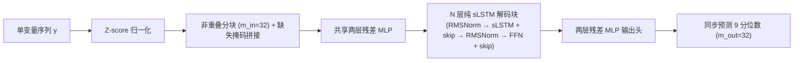

# TiRex

TiRex 是一套基于纯标量长短期记忆网络（sLSTM）的零样本时间序列概率预测基础模型，参数规模约 35M[^src-tirex]。针对现有基础模型在「上下文模式提取」与「长程状态追踪」之间难以兼顾、且逐窗自回归回喂点估计会切断不确定性传递的问题，TiRex 在输入分块中显式拼接缺失掩码，并以连续块掩码策略预训练循环状态解码器；推理时只需把超长预测窗置为缺失占位，即可在不回喂点估计的前提下连续推进隐藏状态并同步输出多步分位数分布[^src-tirex]。

## 问题定位

围绕零样本时间序列预测，既有架构路线存在两处相互耦合的局限[^src-tirex]。其一在**主干表达与状态追踪**：以 [[timesfm|TimesFM]] 和 [[chronos|Chronos-Bolt]] 为代表的 Transformer 架构擅长通过注意力提取上下文模式，但缺少显式的循环状态更新，往往需要更大参数量（200M 至 500M）支撑泛化[^src-tirex][^src-timesfm][^src-chronos]；而如果换用矩阵记忆型循环单元（mLSTM）或混合 xLSTM 栈，模型在长程零样本预测上的表现又会大幅退化[^src-tirex]。

其二在**多步解码与不确定性传递**：常规多块自回归预测需要将前一步生成的点估计（例如中位数）回喂给模型才能继续往后滚动，这不仅会在长程上积累漂移，还会把每一步的分布信息压缩成单点，从而切断预测不确定性向更远未来的延续[^src-tirex]。TiRex 试图用纯 sLSTM 状态追踪配合占位式掩码解码，同时缓解这两重瓶颈[^src-tirex]。

## 机制拆解

剥离论文自定义术语后，TiRex 的前向计算完全由标准算子组合而成：**单序列 Z-score 归一化 + 非重叠分块并拼接二值掩码 + 共享两层残差 MLP 编码 + 堆叠纯 sLSTM 残差解码块（含 RMSNorm 与 FFN）+ 两层残差 MLP 多分位数输出头**[^src-tirex]。模型彻底删去了混合 xLSTM 中的 mLSTM 分支，也不包含自注意力层，训练时仅在非缺失位置计算分位数（pinball）损失[^src-tirex]。

其核心训练与推理机制**连续块掩码（Contiguous Patch Masking, CPM）**包含两条协同设计[^src-tirex]：

- **训练期连续遮蔽**：按均匀采样的连续块数与掩码比例随机遮蔽输入分块并置零，把对应二值掩码拼进输入特征，迫使 sLSTM 仅依靠循环隐藏状态跨过长段缺失继续预测后续分块[^src-tirex]。预训练还叠加三项数据增强：幅值调制（概率 $0.5$）、序列截断（概率 $0.5$）与周期尖峰注入（概率 $0.05$）[^src-tirex]。
- **推理期占位延续**：在真实历史上下文之后直接拼接对应预测长度的缺失占位块（输入置零、掩码置 $1$），前向一次或分块连续推进隐藏状态并直接读出九个分位数，彻底免去把点预测重新喂回输入端的环节[^src-tirex]。

## 数据流与维度

> **维度符号**：$L$ 序列总时间步数（上下文上限 $2048$）；$m_{\text{in}}=m_{\text{out}}=32$ 分别为输入与输出分块长度；$P$ 分块总数（推理时等于历史块数加未来占位块数）；$d$ 解码器隐藏维；$N$ 解码块层数（$N$ 与 $d$ 的具体数值在正文未展开，仅见论文附录）；$|Q|=9$ 为分位数数量（$Q=\{0.1,\dots,0.9\}$）[^src-tirex]。

### Stage 1 · 单序列归一化与掩码分块编码

输入单变量序列先按自身均值 $\bar{y}$ 与标准差 $\sigma_y$ 做尺度归一化，再切分为互不重叠的定长块并与二值缺失掩码 $M$ 拼接，最后由共享残差 MLP 映射至解码器宽度 $d$[^src-tirex]。

$$\begin{aligned}
\tilde{y} &= \frac{y - \bar{y}}{\sigma_y} && \text{// } [L] \to [L]\ \text{——单序列 Z-score 归一化消除量纲差异} \\
U &= [\,Y_{\text{patch}} \odot (1 - M),\; M\,] && \text{// } [P, m_{\text{in}}] \oplus [P, m_{\text{in}}] \to [P, 2m_{\text{in}}]\ \text{——拼接观测分块与二值缺失掩码（} m_{\text{in}}=32 \text{）} \\
H^{(0)} &= \operatorname{ResMLP}_{\text{in}}(U) && \text{// } [P, 2m_{\text{in}}] \xrightarrow{\text{共享两层残差 MLP}} [P, d]\ \text{——将数值与掩码特征联合映射到隐藏维 } d
\end{aligned}$$

### Stage 2 · 纯 sLSTM 因果解码堆叠

编码后的分块特征依次通过 $N$ 个结构相同的 Pre-RMSNorm 解码块；由于未采用 mLSTM 或注意力，跨分块的全部历史记忆都压缩在 sLSTM 的标量门控隐状态中向前传递[^src-tirex]。

$$\begin{aligned}
\tilde{H}^{(l)} &= H^{(l-1)} + \operatorname{sLSTM}\!\left(\operatorname{RMSNorm}(H^{(l-1)})\right) && \text{// } [P, d] \xrightarrow{\text{因果标量循环递推}} [P, d]\ \text{——跨过历史与未来占位块延续隐状态} \\
H^{(l)} &= \tilde{H}^{(l)} + \operatorname{FFN}\!\left(\operatorname{RMSNorm}(\tilde{H}^{(l)})\right) && \text{// } [P, d] \xrightarrow{\text{逐块前馈非线性变换}} [P, d]\ \text{——第 } l=1,\dots,N \text{ 层残差输出}
\end{aligned}$$

### Stage 3 · 多分位数并行输出与监督

末层隐藏表示经两层残差 MLP 映射为每个分块对应的未来 $m_{\text{out}}$ 步、共 $|Q|=9$ 个分位数预测值，训练期仅对非缺失目标位置计算分位数损失[^src-tirex]。

$$\begin{aligned}
\hat{Y}_Q &= \operatorname{ResMLP}_{\text{out}}(H^{(N)}) && \text{// } [P, d] \xrightarrow{\text{两层残差 MLP}} [P, m_{\text{out}}, |Q|]\ \text{——每块输出 } |Q|=9 \text{ 条分位数轨迹（} m_{\text{out}}=32 \text{）} \\
\mathcal{L} &= \frac{1}{|Q|\,m_{\text{out}}}\sum_{t,q}\rho_q\!\left(y_t - \hat{y}_t^q\right) && \text{// } [P_{\text{eval}}, m_{\text{out}}, |Q|] \xrightarrow{\text{仅在非缺失位置求平均}} \mathbb{R}\ \text{——端到端优化分位数回归损失}
\end{aligned}$$

## 与既有工作的关系

在单变量零样本时序基础模型谱系中，TiRex 与代表性近邻形成三类明确的结构与实证对照[^src-tirex]：

- **同槽位互斥对照与实证复现对齐（vs [[timesfm|TimesFM]] / [[chronos|Chronos-Bolt]]）**：在序列主干与多步展开两个槽位上，TiRex 用纯 sLSTM 与 CPM 占位延续替换了 Transformer 注意力和自回归点估计回喂，参数量从 200M/500M 压缩至 35M[^src-tirex][^src-timesfm][^src-chronos]。论文在相同预训练数据与相同增强下重新训练 Chronos-Bolt 作为受控对照，验证了纯架构与解码机制带来的长程优势[^src-tirex]。
- **实证复现对齐（vs [[zeus|Zeus]]）**：TiRex 原文在剔除 16 个重叠设置的 81 项 GiftEval-ZS 上报告排名第一[^src-tirex]；而后续 [[zeus|Zeus]] 在完整 97 项 GIFT-Eval 上同台评测，报告 Zeus 取得 MASE 0.693 / CRPS 0.480、优于 TiRex 的 0.716 / 0.488，两份报告评测子集覆盖范围不同[^src-2607-01918]。
- **跨槽位架构差分（vs 混合 xLSTM）**：TiRex 在循环算子选择上彻底剔除 mLSTM、只保留纯 sLSTM；消融表明一旦反向改为纯 mLSTM，长程预测性能会急剧退化，而只要混入 1 层 sLSTM 即可大幅恢复[^src-tirex]。
- **同词异构与多变量能力对照（vs [[baguan-ts|Baguan-TS]]）**：TiRex 仅支持单变量输入，其「上下文学习」实为依靠纯 `sLSTM` 隐状态追踪单条历史窗口；[[baguan-ts|Baguan-TS]]（ICML 2026）则构建多示例跨样本 ICL，以时间–变量–上下文 3D 轴分解与 Y-space 近邻检索支持单目标加多元协变量预测，并在 [[fev-bench|fev-bench-cov]] 上将 TiRex 纳入同台对照[^src-baguan-ts]。
- **实证复现对齐（vs [[fev-bench]]）**：TiRex 原文在剔除重叠的 81 项 GiftEval-ZS 上报告第一[^src-tirex]；而在涵盖 7 域 100 任务（含 46 项协变量与 35 项多变量任务）并引入 $B=1000$ 任务级配对 Bootstrap 95% 置信区间的 [[fev-bench]] 上，Chronos-2 居于 SQL 与 MASE 双项首位，TiRex 与 [[timesfm|TimesFM-2.5]] 的 95% 置信区间大幅重叠、第二名在统计上不可区分[^src-fev-bench]。

| 模型 | 主干算子 | 多步预测展开 | 输出形式 | 代表参数规模 |
|---|---|---|---|---|
| **TiRex** | 纯 sLSTM 解码块 | CPM 缺失占位连续延续状态 | 9 分位数并行预测 | 35M[^src-tirex] |
| [[timesfm\|TimesFM]] | Decoder-only Transformer | 逐 patch 自回归回喂 | 点预测为主 | 200M[^src-timesfm] |
| [[chronos\|Chronos]] / Chronos-Bolt | T5 编解码 Transformer | 离散 token 或 patch 自回归 | 离散分布 / 分位数 | 200M–800M[^src-chronos] |
| [[zeus\|Zeus]] | U 形多尺度 Encoder-only Transformer | 尾部预测掩码一次性重建 | 9 分位数重建 | 约 100M[^src-2607-01918] |

## 证据

论文在 GiftEval-ZS（剔除重叠后的 81 项设置）与 Chronos-ZS（27 个数据集）上报告了零样本概率预测与消融结果（均采用作者报告口径）[^src-tirex]：

1. **定位与主结论**：35M 参数的 TiRex 在 GiftEval-ZS 与 Chronos-ZS 的概率指标（CRPS 与 WQL）及综合排名均位列第一，在长程零样本预测上首次超越监督训练的 [[patchtst|PatchTST]] 与 [[tft|TFT]]；推理速度较 Chronos-Bolt-Base 快 4 倍以上、较 TimesFM-2.0 快 11 倍以上[^src-tirex]。
2. **真实涨点归因**：消融验证收益同时来自纯 sLSTM 与 CPM 多块机制——取消多块连续推理退化为自回归会使 GiftEval-ZS 长程 CRPS 从约 $0.33$ 恶化至约 $0.37$，改用末尾朴素掩码会损害短程与 Chronos-ZS（约 $0.59$ 恶化至约 $0.65$）；主干换成纯 mLSTM（约 $0.43$）或 Transformer（约 $0.34$）长程均落后，同数据同增强重训的 Chronos-Bolt 长程仍落后（约 $0.41$）；数据增强整体有效，但去掉幅值调制虽使 Chronos-ZS 从约 $0.59$ 退化至约 $0.62$，在 GiftEval-ZS 上却略有微升[^src-tirex]。
3. **证据缺口与负结果**：第一，模型仅支持单变量输入，不具备跨通道联合建模能力；第二，GiftEval-ZS 主评测排除了 97 项中的 16 项重叠设置（实测 81 项），与完整 97 项评测口径不可混比；第三，超参数未经过精细调优，且解码块深度 $N$ 与隐藏维度 $d$ 等结构尺寸在正文中未给出具体数值[^src-tirex][^src-2607-01918]。

## 相关页面

- [[source-tirex]] — 论文源摘要
- [[timesfm]] — Transformer decoder-only 时序基础模型对照
- [[chronos]] — 离散化与 Chronos-Bolt 自回归基础模型对照
- [[zeus]] — 完整 97 项 GIFT-Eval 上的同台对照基础模型
- [[ar-vs-nar-decoding]] — 自回归、非自回归与占位式状态延续解码取舍
- [[in-context-learning]] — 单序列上下文条件化与少样本演示的边界辨析
- [[patchtst]] / [[tft]] — 长程零样本评测中超越的监督基线
- [[baguan-ts]] — 序列原生多示例协变量 ICL 对照（跨样本检索 vs 单序列 sLSTM 隐状态延续）
- [[fev-bench]] — 含协变量与配对 Bootstrap 95% CI 的零样本基准（与 TimesFM-2.5 第二名统计不可分）

[^src-tirex]: [[source-tirex]]
[^src-timesfm]: [[source-timesfm]]
[^src-chronos]: [[source-chronos]]
[^src-2607-01918]: [[source-2607-01918]]
[^src-baguan-ts]: [[source-baguan-ts]]
[^src-fev-bench]: [[source-fev-bench]]
